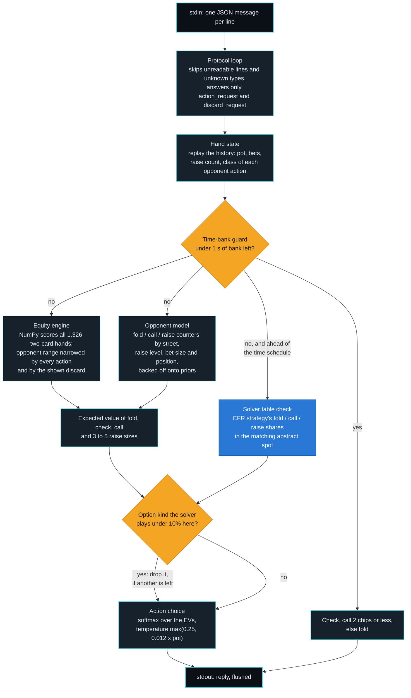
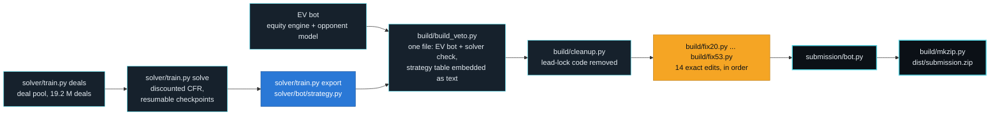

<div align="center">

# Hakari

**A heads-up Discard Hold'em bot for Synergy '26 Pokerbots.**<br>
Equity engine + opponent model + CFR strategy table, in one `bot.py`, NumPy only, paced to stay inside the time bank.

### ALWAYS BET ON HAKARI

*In Jujutsu Kaisen, Hakari's domain expansion is a jackpot gamble. This bot's domain is the table: it reads the opponent, prices every move, and pushes its edge whenever the odds are on its side.*

[](https://www.python.org/)
[](https://numpy.org/)
[](submission/bot.py)
<br>
[](#results)
[](#time-and-memory-safety)
[](#time-and-memory-safety)

</div>

Team Hakari's entry for the Pokerbots event of Synergy '26, IIIT Bangalore. The submission is one file, [`submission/bot.py`](submission/bot.py), using only the Python standard library and NumPy. The uploaded zip is in this [Google Drive folder](https://drive.google.com/drive/folders/1zGLkUOj07K3-cgPINSvE-vTaAxlzoEnk?usp=sharing).

The bot picks every move by expected value: it estimates its equity against a range of opponent hands, and it learns how often this opponent folds, calls and raises. A precomputed game-theory strategy, trained with counterfactual regret minimisation (CFR), follows every hand, and a move that strategy would almost never make in the current spot is dropped. The bot exploits the opponent but stays close to sound play.

The entry is version `cand83`. `submission/bot.py` has md5 `f0ddf15aa0d1b9651e5e9f117ca60dc6`, and the upload zip has md5 `8e895671d6bb4d12ad5df8d4d44fed1a` ([`results/engine_checks_cand83.txt`](results/engine_checks_cand83.txt)).

## Contents

- [The game](#the-game)
- [Quick start](#quick-start)
- [How the bot works](#how-the-bot-works)
- [Time and memory safety](#time-and-memory-safety)
- [Rules compliance](#rules-compliance)
- [The solver](#the-solver)
- [Rebuilding from source](#rebuilding-from-source)
- [How we tested](#how-we-tested)
- [Results](#results)
- [Development history](#development-history)
- [Limitations](#limitations)
- [Repository layout](#repository-layout)
- [Third-party code and citations](#third-party-code-and-citations)
- [Team](#team)

## The game

| Rule | Value |
|---|---|
| Players | 2, heads-up no-limit |
| Hole cards | 3 each. After the flop betting both players discard 1 card at the same time, and both discards are shown. Turn and river are played with 2 hole cards. |
| Stacks and blinds | 200 chips, reset every hand. Blinds 1 and 2. |
| Raises | At most 4 bets or raises per street. The big blind counts as the first one preflop. |
| Match | Two legs, each with fresh bot processes. Leg 2 replays every deal of leg 1 with cards and seats swapped. Stage 1: 200 deals per leg, 30 s time bank per leg. Stage 2: 500 deals per leg, 75 s per leg. |
| Scoring | The bot with more chips over both legs wins the match: 1 point, 0.5 for a draw. Tie-break: capped chips per hand (each match clipped to plus or minus 400 in Stage 1, 1,000 in Stage 2). |
| Tournament | Stage 1: 6-round Swiss. Stage 2: the top 32 play a full round robin, with scores reset. |

## Quick start

Requirements: Python 3.11 and NumPy. No other package is needed, and the bot reads no files.

The organisers' starter kit (`engine.py`, the example bots, the rulebook and the protocol) is their material and is not included here. Put it in `docs/starter_kit/`.

1. Install NumPy.

   ```
   pip install numpy
   ```

2. Play a Stage 2 match against the organisers' example bot on the official engine.

   ```
   python docs/starter_kit/engine.py submission/bot.py docs/starter_kit/example_bots/random_bot.py --stage 2 --seed 1 --python "$(which python3.11)"
   ```

   Add `--hands 20` for a short check.

3. Build the upload zip: `bot.py` alone at the top level, with a fixed time stamp so the zip is the same byte for byte on every build.

   ```
   python build/mkzip.py submission/bot.py dist/submission.zip
   ```

   It prints the md5 of the zip and of `bot.py`. Both match the values above.

## How the bot works



1. **State.** Every request replays the history the engine sends. The bot tracks the pot, both bets, the raise count and the class of each opponent action: fold, check or call, or raise (small, medium, big, all-in).
2. **Hand tables.** On each street, NumPy scores all 1,326 two-card hands on the current board. The turn and river are enumerated exactly. The flop samples up to 240 runouts, fewer when time runs short. Preflop and flop decisions use 3-card hands and a model of which two cards each player keeps.
3. **Opponent range.** A weight for every possible opponent hand. Each opponent action is read as a slice of the strength order: a raise this opponent makes 20% of the time keeps the strongest 20% of the remaining range, softened by a learnt rate of off-pattern plays such as bluffs and slow-plays. The shown discard removes hands the opponent would not have thrown that card from. How this opponent discards (best keep, lowest card, or random) is learnt from showdowns.
4. **Opponent model.** Counters of the opponent's fold, call and raise choices at three levels of detail (all streets, per street, per bet size). They start from priors and move towards this opponent's habits. After the flop, the opponent's first action on a street is counted by position, because opening a street and answering our check are different decisions. Preflop, the big blind's answer to our limp and the opponent's own button open have separate counters.
5. **Expected value.** Fold is 0. A call wins its equity share of the pot, adjusted for the streets still to come. A raise adds the chance the opponent folds now, and values their call and their re-raise separately. Raise sizes come from the pot (a third, two thirds, one pot, one and a half pots, all-in) and from the bet faced.
6. **Solver check.** The CFR strategy follows the same hand. If it plays an option kind (fold, check or call, raise) under 10% of the time in the matching spot, that kind is removed, as long as another option remains. The check is off when the real bet has no matching size in the solver's tree, when the real price to call is under 0.8 of the price the tree answered, and when the hand has left the tree. Once the big blind has raised at least 60% of at least 5 of our limps, a hand the solver would not open may fold instead of limping, and the bot's own model answers the raise.
7. **Choice.** A softmax over the remaining EVs. Options more than three temperatures below the best are never picked. The randomness stops an observant opponent from reading exact thresholds.

## Time and memory safety

How the bot handles time, from [`submission/bot.py`](submission/bot.py):

- Every request carries `time_left_ms`, and the bot reads it each time.
- Flop runouts are sized to spend about 40% of a fair per-hand share of the remaining bank, between 12 and 240.
- The solver check runs only while the bank is ahead of a schedule that spreads 80% of it evenly over the hands; 20% is kept for slow spells.
- Below 1 s of bank, it checks, calls 2 chips or less, or folds, with no further work.
- Any exception inside a decision falls back to a legal check, fold or discard, so a bad message cannot crash it.
- NumPy's BLAS library is held to one thread before NumPy loads, so start-up does not reserve address space per core.

Release checks on the entry, `cand83` ([`results/engine_checks_cand83.txt`](results/engine_checks_cand83.txt), [`results/slow_core_cand83.txt`](results/slow_core_cand83.txt), [`results/numpy_versions_cand83.txt`](results/numpy_versions_cand83.txt), [`results/audit_cand83.txt`](results/audit_cand83.txt)). The engine reports time used summed over both legs.

| Check | Result |
|---|---|
| Organisers' engine, Python 3.11.15, NumPy 2.4.6 | 11 matches: 0 forfeits, 0 notices, 0 stderr lines |
| Time used, Stage 2 against the starter bot | 54.64 to 55.60 s over both legs, against a bank of 75 s per leg |
| CPU slowed to one sixth | Stage 1: 25.6 s of 30 s per leg. Stage 2: 65.1 s of 75 s per leg. 0 notices. |
| Core shared with two CPU hogs | 0 notices in Stage 1 and Stage 2 |
| Start-up to exit | 0.75 to 0.77 s (limit 5 s) |
| Peak resident memory | at most 75,904 kB over the 11 matches (limit 1 GB) |
| Address space at start-up | 140 MB with one BLAS thread, so it starts under a 256 MB address-space cap; with one thread per core it was 672 MB on a 14-core server (measured on `cand72`, which has the same start-up code; [review round](results/review_round_8nov.txt)) |
| Unknown message types and fields | Ignored, 0 notices |
| A 998-hand match | Clean |
| NumPy 1.26 and 1.23 | Clean |
| `lab/audit.py` on match logs | No move that loses whatever the opponent holds, in 4,070 river decisions and 302 turn folds |

Each earlier entry (`cand41`, `cand49`, `cand55`, `cand72`) passed the same checks: see the `engine_checks_*`, `slow_core_*`, `numpy_versions_*` and `audit_*` files in [`results/`](results/).

## Rules compliance

| Rule (rulebook section) | What this entry does |
|---|---|
| Python 3.11; standard library, NumPy and SciPy only (5.1, 5.2) | Standard library and NumPy. Tested on Python 3.11 under NumPy 2.4.6, 1.26 and 1.23. |
| 1 vCPU, 1 GB RAM (5.3) | One core and one BLAS thread. Peak resident memory and address space in [Time and memory safety](#time-and-memory-safety). |
| No network, read-only file system, no writing files, no subprocesses (5.4) | None of these are used. Every table is embedded in `bot.py` and decoded in memory at start-up. |
| Time bank per leg, 5 s per reply, 5 s start-up (5.5 to 5.7) | Paced against the bank, simpler play when it runs short; start-up to exit under 1 s. See [Time and memory safety](#time-and-memory-safety). |
| Only protocol messages on stdout (5.8) | Replies only to `action_request` and `discard_request`, one JSON line each, flushed. 0 stderr lines in the release checks. |
| No state between legs; no attempt to link the two plays of a deal (5.9, 10.3) | Each leg starts from the same priors. Nothing is written or read between legs. |
| One `bot.py`, or a zip with `bot.py` at the top, at most 5 MB (5.10) | One `bot.py` of 1,450,493 bytes. The zip is 1,030,991 bytes. |
| Own work; published algorithms allowed (10.1) | All code was written by the team. The algorithms are published ones: CFR and its discounted variant, pseudo-harmonic action mapping, Bayesian range updates. See [Citations](#third-party-code-and-citations). |
| Code review of prize winners (10.4) | The strategy table and the bot build can be rebuilt from this repository: see [Rebuilding from source](#rebuilding-from-source). |

## The solver

The trainer and the abstraction are in [`solver/`](solver/), and [`solver/NOTES.md`](solver/NOTES.md) gives the details.

| Part | Choice |
|---|---|
| Cards, preflop | Exact suit-isomorphic class of the 3 hole cards: 1,755 buckets |
| Cards, flop | Mean and spread of the best two-card keep's percentile over 48 fixed runouts: 512 buckets |
| Cards, turn and river | Strength against the opponent's plausible kept hands: 192 buckets each |
| Bets | Preflop open 1 or 2 pots, first re-raise 0.75 pot. Postflop first bet 0.33, 0.66 or 1 pot, first raise 0.75 pot. Later raises are all-in only. All-in is always offered. |
| Tree | 6,476 public states, 3,392 decision nodes, 758,044 information sets |
| Training | Chance-sampled discounted CFR (alpha 1.5, beta 0, gamma 2) on 19.2 M pre-dealt deals, NumPy passes over the whole tree, 14 worker processes |
| Real bets onto the tree | Randomised pseudo-harmonic mapping between the two nearest abstract sizes, fixed for the rest of the hand |

Playing alone (as `cfrS`), the solver came third in the 14-bot round robin in [Results](#results). It is hard to beat, but it never adapts to a weak opponent. Inside Hakari it is the safety check of step 6 above.

## Rebuilding from source



### 1. The strategy table

From inside `solver/`, on a Linux machine with 14 cores (times and memory in [`solver/NOTES.md`](solver/NOTES.md)):

```bash
python test_solver.py                                          # self-checks, about 1 s
python train.py deals --flops 150000 --workers 14 --out pool.npz
python train.py solve --pool pool.npz --checkpoint ckpt.npz --workers 14 --batch 2048 --hours 8 --every 900
python train.py export --checkpoint ckpt.npz --out bot/strategy.py
```

`solve` writes a checkpoint every `--every` seconds and resumes from `ckpt.npz` if it exists. The committed `solver/bot/strategy.py` is an untrained smoke table; the trained table is embedded in `submission/bot.py`, and its header records the iterations and deals it was trained on. CFR sampling is random, so a new run gives a table of the same kind, not the same bytes.

### 2. The bot build

[`build/build_veto.py`](build/build_veto.py) merges the EV bot and the solver folder (`abstraction.py`, `strategy.py`, `bot.py`) into one file. The arguments below are the ones the shipped constants show (`VETO_P = 0.1`, every option kind, from preflop):

```bash
python build/build_veto.py EV_BOT.py solver/bot fcr 0 b00.py 0.1
python build/cleanup.py b00.py b01.py
```

Then each fix script reads the previous file and writes the next one. Every script replaces exact text and asserts that text occurs once, so a step applied to the wrong input stops the build.

| Order | Script | Environment | What it changes | First shipped in |
|---:|---|---|---|---|
| 1 | [`fix20.py`](build/fix20.py) | | A small re-raise the tree reads as all-in no longer forces folds; discard named by the card, not its position; the big blind's preflop check closes the street | `cand20` |
| 2 | [`fix29.py`](build/fix29.py) | | Bets of all-in minus a few chips: fold rate of a cheap re-raise scaled down; the solver's answer to a near-shove stands | `cand29` |
| 3 | [`fix30.py`](build/fix30.py) | | A call the opponent could not raise over is not read as passive | `cand36` |
| 4 | [`fix31.py`](build/fix31.py) | | The call EV takes the call off the stack once, not twice | `cand36` |
| 5 | [`fix32.py`](build/fix32.py) | `E1=1` | The range behind a rare aggressive action is read from the measured share of weak hands | `cand36` |
| 6 | [`fix34.py`](build/fix34.py) | `W=1` | Range slices interpolated inside equity buckets | `cand41` |
| 7 | [`fix33.py`](build/fix33.py) | | Solver card features rounded as the trainer stored them | `cand41` |
| 8 | [`fix38.py`](build/fix38.py) | | Time panic with no flop tables: the discard result stops early, no stderr line | `cand49` |
| 9 | [`fix40.py`](build/fix40.py) | | A line that is valid JSON but not an object is skipped | `cand55` |
| 10 | [`fix43.py`](build/fix43.py) | | Opponent's first action after the flop counted by position | `cand55` |
| 11 | [`fix44.py`](build/fix44.py) | | One BLAS thread; non-UTF-8 bytes, deep JSON and requests with no legal actions or hole cards no longer end the process | `cand72` |
| 12 | [`fix45.py`](build/fix45.py) | | No solver check when the real price to call is under 0.8 of the price the tree answered | `cand72` |
| 13 | [`fix49.py`](build/fix49.py) | | Preflop: the big blind's answer to our limp has its own counter; each preflop action counted once | `cand83` |
| 14 | [`fix53.py`](build/fix53.py) | | Against a big blind that raises most limps, hands the solver would not open may fold instead of limping | `cand83` |

For example: `python build/fix20.py b01.py b02.py`, then `E1=1 python build/fix32.py b05.py b06.py`, and so on to `submission/bot.py`.

What is not committed as separate files: the starting EV bot and the trained `strategy.py`. The trained table is committed only inside `submission/bot.py`, and each fix script's docstring records why its edit was made.

### 3. The upload zip

```bash
python build/mkzip.py submission/bot.py dist/submission.zip
```

### Play the solver alone

The three solver modules are embedded in `submission/bot.py` as text. This copies them into a `cfrS/` folder, which then runs as the standalone solver bot:

```bash
python - <<'EOF'
import os
s = open("submission/bot.py", newline="").read()
os.makedirs("cfrS", exist_ok=True)
for name, f in (("ABSTRACTION", "abstraction"), ("STRATEGY", "strategy"), ("SOLVER_BOT", "bot")):
    k = "SOLVER_%s = r'''" % name
    a = s.index(k) + len(k)
    open("cfrS/%s.py" % f, "w", newline="").write(s[a:s.index("'''", a)])
EOF
python docs/starter_kit/engine.py cfrS/bot.py docs/starter_kit/example_bots/random_bot.py --stage 2 --seed 1
```

## How we tested

**Match format.** Every test match uses the organisers' engine and the official two-leg format. Each deal is played twice with cards and seats swapped, so card luck largely cancels out. "Long" matches are Stage 2 (500 deals per leg), "short" ones Stage 1 (200 deals per leg).

**Paired comparisons.** A change is tested by running the old and the new version on the same deal sets against the same opponents. Each result gives the difference with its standard error (se), the size of the swing that luck alone can cause. A difference under 2 se is treated as no difference. The bar for shipping is set before the results come in, and seeds are never reused once a decision has been made on them.

**Unit tests and self-checks.** `python -m pytest tests` covers the first framework: hand evaluator, equity code, our own engine and the protocol examples. `python solver/test_solver.py` (run from `solver/`) checks the evaluator, the preflop classes, tree legality, that the trainer and the bot compute the same card features, and raise mapping.

**Test field.** Every opponent was written by the team for testing:

| Group | Bots |
|---|---|
| CFR solvers | cfrS (ours, alone), cfr2 (a smaller solver), f7 and f9 (independent solvers) |
| Written only from the organisers' documents | f1 to f11, each written separately with no view of our code. f10 targets common styles. f11 is the strongest of them. Later f16, f17 and f20, also with no view of this bot or its results. |
| Earlier bots of ours | rival_a, rival_b, rival_c and two variants, plus locker, which folds out a leg once its lead covers the remaining blinds |
| Fixed styles | Simple bots: always call, always shove, maniac, nit, min-raiser, pot-odds caller, loose, tight and others |
| One habit changed | f18, f19 and f21 (copies of this bot with one habit changed), and a3 to a15 (10 bots, each written to one common playing style) |

**Bots built to beat it.** Bots written with the full source code in hand each attack one weakness. Most are copies of the bot with one habit added, so any edge they gain comes from that habit alone. The generators in `lab/`:
- `minrr_gen.py` makes re-raises minimum-sized.
- `disc_gen.py` discards the lowest card, as the starter kit does.
- `minbet_gen.py` bets the minimum.
- `iso_gen.py` raises every limp.
- `njv_gen.sh` and `fz_gen.py` add near-all-in bets, pot-multiple bets or random-sized bets to a copy of the bot.
- `sw_gen.py` switches style halfway through each leg.

A fix has to win its targeted test and must not lose to the general field.

**Code reviews.** Independent reviews checked the code by running it: state tracking against the engine, the opponent model's counters, the EV formulas, equity numbers against a brute-force count, the preflop path, every assumption the solver makes and how its strategy is looked up, and time and forfeit safety (reply times, bank pacing, start-up and every crash path). A final review round ran six reviews of `cand55` side by side, including a fuzzer with odd opponents; every finding was tested on the server before any change ([review round](results/review_round_8nov.txt)).

**Main tools in `lab/`:**

| Tool | Job |
|---|---|
| `legrun.py`, `rrun.py` | Run many two-leg matches in parallel on the organisers' engine (one bot against many, or all pairs) |
| `legsum.py`, `mrsum.py`, `pairavg.py`, `rrsum.py` | Paired comparison with standard errors (`pairavg.py` averages repeated runs of a deal set first), per-opponent tables, round-robin standings |
| `ob_audit.py` | For every answer to a bet of 1.2x the pot or more: chips gained compared with folding, by street, answer and bet size |
| `audit.py` | Moves that lose whatever the opponent holds: river folds of the best possible hand, river calls with a hand that beats nothing, turn folds of a hand that cannot lose |
| `dup.py` | Duplicate-deal divergence: finds the first decision where we and the opponent chose differently with the same cards, and totals the chips that followed |
| `rr.py` | How deep re-raises are sized and answered |
| `gen_pre2.py` | Rebuilds the preflop table with exact card removal, with a brute-force self-test |
| `newcheck.sh`, `slow6.sh`, `npcheck.sh` | Release checks: organisers' engine, unknown messages, start-up time, memory, slowed CPU, older NumPy |

## Results

All numbers come from matches on the organisers' engine, in the official two-leg format, on deals never used to tune the bot. The files in [`results/`](results/) hold the raw summaries. Most rounds test an earlier version; each version is the one before it plus the fixes in [Development history](#development-history).

**Stage 2 round robin of the 14 strongest test bots**, played by `cand20` (500 duplicate deals per match, 8 deal sets per pair, 728 matches, 0 forfeits, [`results/round_robin_stage2.txt`](results/round_robin_stage2.txt)):

| Rank | Bot | Match points | Capped chips |
|---:|---|---:|---:|
| 1 | **Hakari (this bot)** | **91.0 of 104** | **+76,217** |
| 2 | f11, written from the organisers' documents | 69.0 | +43,930 |
| 3 | cfrS, our CFR solver playing alone | 66.0 | +6,014 |
| 4 | f7, a second, independent CFR solver | 65.0 | +39,468 |
| 5 | rival_a | 64.0 | +7,360 |
| 6 | f10, built to exploit common styles | 62.0 | +25,499 |

It won the head-to-head against every other bot except f7, where it won 4 of 8.

| Round | Version | Result | File |
|---|---|---|---|
| Round robin of the 8 strongest (Stage 2, 6 deal sets per pair, 168 matches) | `cand41` | First with 34 of 42 points, ahead of f11 (26), rival_a2 (25) and f7 (22). Won the head-to-head against all seven others, including f16 and f17 (5 of 6 each) and f7 (5 of 6). | [`round_robin_8.txt`](results/round_robin_8.txt) |
| Round robin of the 12 strongest (Stage 2, 4 deal sets per pair) | `cand55` | Second with 33 of 44, behind f21 with 37. On 96 fresh head-to-head matches against f21, `cand55` won 56. | [`round_robin_12.txt`](results/round_robin_12.txt), [`f21_followup.txt`](results/f21_followup.txt) |
| All 23 bots built to beat it | `cand41` | 283 of 368 long matches won, 0 forfeits | [`attackers_vs_cand41.txt`](results/attackers_vs_cand41.txt) |
| f16 and f17, written from the organisers' documents only | `cand36` | 29 and 28 of 32 long matches won, 27 and 18 of 32 short ones | [`blind_rivals.txt`](results/blind_rivals.txt) |
| f20 and 10 single-style bots | `cand55` | 175 of 176 long and 163 of 176 short matches won | [`new_rivals.txt`](results/new_rivals.txt) |
| The other 28 test bots | `cand55` | 111 of 112 long and 106 of 112 short matches won, 0 forfeits | [`rest_cand55.txt`](results/rest_cand55.txt) |
| The entry against the version before it, 10 paired comparisons | `cand83` vs `cand72` | 2,576 matches: +11.5 match points (se 23.7), that is +0.45 points per 100 matches (se 0.92); 0 forfeits and 0 time notices | [`cand83_vs_cand72_field.txt`](results/cand83_vs_cand72_field.txt) |

## Development history

[`decisions.tsv`](decisions.tsv) holds one row per decision: what, why, the evidence and the result. The shipped changes, each tested against the version before it on the same deals:

| Version | Change | Evidence |
|---|---|---|
| base | EV bot with an opponent model, plus the solver check from preflop at a 10% threshold; lead lock removed, because under the two-leg rules a leg cannot see the other leg's chips | [`decisions.tsv`](decisions.tsv) steps 1 to 8 |
| `cand20` | A small re-raise late in a betting round was read as an all-in by the solver's tree, forcing folds ([`fix20.py`](build/fix20.py)) | Against bots that re-raise small: +172 capped chips per match (se 86) and +3 points (se 2.6) ([`cand20_vs_small_reraisers.txt`](results/cand20_vs_small_reraisers.txt)); general field -4 points (se 9.4) over 488 matches ([`cand20_vs_cand19_field.txt`](results/cand20_vs_cand19_field.txt)) |
| `cand29` | Bets just below all-in were read as cheap, and the solver check was off for them ([`fix29.py`](build/fix29.py)) | A bot that bets all-in minus 2 chips beat `cand20` in 31 of 32 long matches; `cand29` won 17 of 32 against it, +16 points (se 3.2) ([`near_allin_attacker.txt`](results/near_allin_attacker.txt)) |
| `cand36` | The share of weak hands behind big bets was applied as a per-hand weight; a call at the raise cap read as "chose not to raise"; the call EV took the call off the stack twice ([`fix30.py`](build/fix30.py), [`fix31.py`](build/fix31.py), [`fix32.py`](build/fix32.py)) | Against bots that bet 2x the pot or a random size with strong hands: +32 points over 128 deal sets (se 7.5) ([`big_bet_attackers.txt`](results/big_bet_attackers.txt)); general field +11 (se 7.0) over 240 long matches ([`cand36_vs_cand29_field.txt`](results/cand36_vs_cand29_field.txt)) |
| `cand41` | Range slices read inside equity buckets; solver features rounded as in training ([`fix34.py`](build/fix34.py), [`fix33.py`](build/fix33.py)) | +20 points (se 8.5) over 240 short matches, better against 9 of 10 strong bots; -4 (se 6.9) over 240 long ones ([`cand41_vs_cand36_field.txt`](results/cand41_vs_cand36_field.txt)); +14.5 (se 6.5) on 240 fresh long matches ([`cand41_vs_cand36_stage2_more.txt`](results/cand41_vs_cand36_stage2_more.txt)) |
| `cand49` | Time-panic guard: the discard result skipped when no flop tables exist ([`fix38.py`](build/fix38.py)) | With the bank cut to 900 ms: 181 stderr lines before, 0 after ([`time_panic_cand49.txt`](results/time_panic_cand49.txt)) |
| `cand55` | Input guard ([`fix40.py`](build/fix40.py)); one counter held two decisions after the flop, opening a street and answering our check ([`fix43.py`](build/fix43.py)) | Input guard: exit code 1 before, 0 after ([`input_guard.txt`](results/input_guard.txt)); `cand55` plays the same moves as `cand53`, its build without the guard: match logs identical on three fixed deal sets ([`cand55_vs_cand41_field.txt`](results/cand55_vs_cand41_field.txt)). Counters: a practice bot that always checks first and bets when checked to won 27 of 32 long matches against `cand49`; after the fix +14 points (se 3.2) long and +11 (se 3.7) short against it ([`practice_bots_night.txt`](results/practice_bots_night.txt)) |
| `cand72` | One BLAS thread and three crash paths closed ([`fix44.py`](build/fix44.py)); no solver check for bets much cheaper than the tree size ([`fix45.py`](build/fix45.py)) | Start-up address space 672 MB down to 140 MB. A copy of `cand55` that bets the minimum where it would check beat it by 316 chips per long match (se 96); `cand72` beat the same copy by 1,128 (se 115). Over 3,248 paired matches: -23.5 match points (se 26.9) ([review round](results/review_round_8nov.txt), [`cand72_vs_cand55_field.txt`](results/cand72_vs_cand55_field.txt)) |
| `cand83` | Against a big blind that raises every limp, the solver check forced limp-then-fold: 77 of 78 limps in one 1,000-hand match ([`fix49.py`](build/fix49.py), [`fix53.py`](build/fix53.py)) | A bot that raises every limp to 10 and bets after our checks took 403 chips per long match more from `cand72` than its control (se 102). After the fix, against the bot that only raises every limp: +221 chips per long match over `cand72` (se 104), and every reader's gain over its control within luck ([limp round](results/limp_round_9nov.txt), [`cand83_vs_cand72_field.txt`](results/cand83_vs_cand72_field.txt)) |

Tested and not shipped (below the 2-se bar set before the results, or worse):

| Change | Evidence |
|---|---|
| Solver check off after the flop against bots that discard by a fixed rule | -12 points (se 3.3) over 96 Stage 2 matches against such bots ([`cand21_rejected.txt`](results/cand21_rejected.txt)) |
| Six changes after `cand41`: flop range slices in the action model's order, a solver retrained with smaller re-raises, no solver check facing an all-in, each preflop action counted once, and two counter splits | None beat `cand41` beyond luck ([`candidates_after_cand41.txt`](results/candidates_after_cand41.txt), [`decisions.tsv`](decisions.tsv) steps 28 to 33) |
| Separate counters for 0.66-pot and pot-sized bets | -3 points (se 1.7) long and +5 (se 3.6) short against the new test bots ([`size_slots.txt`](results/size_slots.txt)) |
| f21's rule: on the flop, out of position, after checking, fold to a bet unless equity is at least 0.45 | `cand55` won 56 of 96 head-to-head matches against f21; the rule added +2 points (se 6.5) on the general field ([`f21_followup.txt`](results/f21_followup.txt)) |
| No preflop all-in while it is more than three pots (`cand73`) | +52 capped chips per long match (se 26.1) against a bot that calls all-ins only with its strongest hands ([review round](results/review_round_8nov.txt)) |
| No all-in above three pots on any street (`cand74`, `cand76`) | Level head to head: +3.0 (se 7.0) and +2.0 (se 7.5) over 120 matches; against a loose all-in caller `cand76` won 75 of 120 where `cand72` won all 120 ([all-in round](results/allin_round_8nov.txt)) |
| The all-in offered at every size (`cand75`, `cand77`) | -28.0 points (se 7.6) and -23.0 (se 7.4) head to head ([all-in round](results/allin_round_8nov.txt)) |
| Broader limp fixes (`cand79`, `cand80`, `cand81`) | `cand79`: +916 chips per long match against the limp raiser (se 115) but -10 match points in 64 short matches against f16 and f17 (se 4.3); `cand80`: +65 chips (se 87), short of its bar ([limp round](results/limp_round_9nov.txt)) |

## Limitations

- Every opponent in these results was written by the team for testing, so the strength of the real field is unknown.
- f7, an independent CFR solver, is the closest matchup: `cand20` won 4 of 8 against it in the 14-bot round robin. A stronger solver than any we built could beat this bot.
- f17, built around fast opponent modelling, won 14 of 32 short Stage 1 matches against `cand36`, but only 4 of 32 long ones ([`blind_rivals.txt`](results/blind_rivals.txt)). Short matches give our opponent model less time to learn.
- f21, a copy of this bot with one extra fold rule, finished 4 points ahead of it in the 12-bot round robin. Over 96 more matches this bot won 56. A difference of a few match points either way is within luck.
- The limp fix in `cand83` is neutral in match points: the bots it was built against lost to `cand72` in 119 and 120 of 120 matches anyway. It removes a chip leak a stronger opponent could use.
- The opponent model starts from the same priors in both legs. Learning restarts with each fresh process, as the rules require.
- On a machine much slower than one sixth of our test server, the flop runouts and the solver check are cut back, and play gets simpler.

## Repository layout

| Path | Contents |
|---|---|
| [`submission/bot.py`](submission/bot.py) | The entry. Self-contained: the decision code, the preflop table and the trained solver, embedded as compressed text. |
| [`build/`](build/) | How the entry was assembled: `build_veto.py`, `cleanup.py`, the 14 fix scripts and `mkzip.py`. See [Rebuilding from source](#rebuilding-from-source). |
| [`solver/`](solver/) | The CFR trainer (`train.py`), the abstraction it solves (`bot/abstraction.py`), a standalone solver bot, self-checks and [`NOTES.md`](solver/NOTES.md). `bot/strategy.py` here is an untrained smoke table. |
| [`lab/`](lab/) | The test harness: match runners, paired comparisons, the round robin, the divergence analysis, test-opponent generators and the release checks. |
| [`lab/candidates/`](lab/candidates/) | Patches for changes that were tested and not shipped. |
| [`results/`](results/) | Result summaries cited in this README. |
| [`decisions.tsv`](decisions.tsv) | One row per decision: what, why, the evidence, and what happened. |
| [`pokerbots/`](pokerbots/), [`scripts/`](scripts/), [`tests/`](tests/) | The first framework: our own engine, hand evaluator, equity code and early bots, with unit tests. The final bot does not import it. |
| [`docs/RELEASE_DAY.md`](docs/RELEASE_DAY.md) | The checklist for an upload. |

## Third-party code and citations

- NumPy, for all array work. No other library.
- Counterfactual regret minimisation: M. Zinkevich, M. Johanson, M. Bowling, C. Piccione, "Regret Minimization in Games with Incomplete Information", NeurIPS 2007.
- Discounted CFR: N. Brown, T. Sandholm, "Solving Imperfect-Information Games via Discounted Regret Minimization", AAAI 2019.
- Monte Carlo sampling for CFR: M. Lanctot, K. Waugh, M. Zinkevich, M. Bowling, "Monte Carlo Sampling for Regret Minimization in Extensive Games", NeurIPS 2009.
- Pseudo-harmonic action mapping: S. Ganzfried, T. Sandholm, "Action Translation in Extensive-Form Games with Large Action Spaces", IJCAI 2013.
- The organisers' starter kit and engine were used for testing. They are not redistributed here.

## Team

Team Hakari, Synergy '26 Pokerbots, IIIT Bangalore:

- Bhavya Jain
- Kanav Bhardwaj
