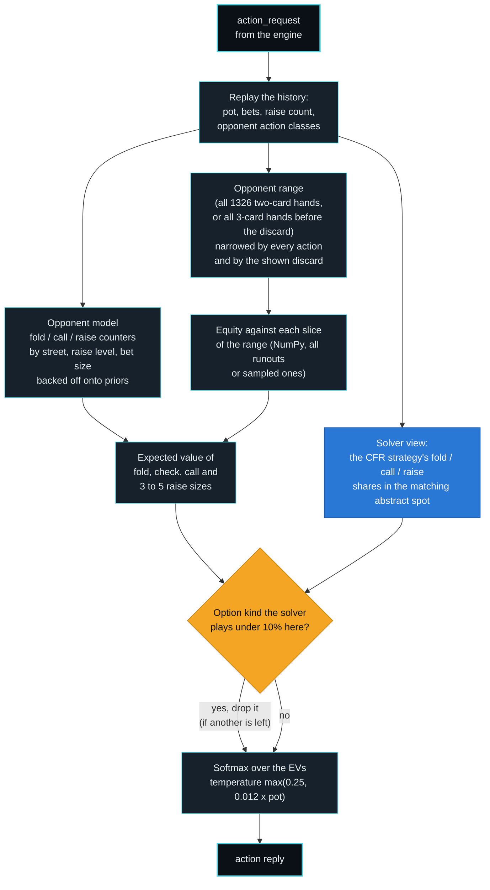

<div align="center">

# Hakari: a Discard Hold'em bot

**Synergy '26 Pokerbots, IIIT Bangalore. Team Hakari.**

[](https://www.python.org/)
[](https://numpy.org/)
[](submission/bot.py)
<br>
[](#results-at-a-glance)
[](#robustness)
[](#robustness)

</div>

This repository is team Hakari's entry for the Pokerbots event of Synergy '26. The game is Discard Hold'em: heads-up no-limit Hold'em with three hole cards, where each player throws one card away face up after the flop betting. The submission is a single file, [`submission/bot.py`](submission/bot.py). It uses only the Python standard library and NumPy. The uploaded zip is in this [Google Drive folder](https://drive.google.com/drive/folders/1zGLkUOj07K3-cgPINSvE-vTaAxlzoEnk?usp=sharing).

The bot makes every decision by expected value. It estimates its equity against a range of opponent hands, and it learns from this opponent's actions how often they fold, call and raise. A precomputed game-theory strategy, trained with counterfactual regret minimisation (CFR), follows every hand. When that strategy would almost never make a move in the current spot, the move is dropped. The result plays like an exploitative bot that stays close to sound play.

**Contents:**
[Results at a glance](#results-at-a-glance) ·
[The game](#the-game) ·
[Quick start](#quick-start) ·
[Repository layout](#repository-layout) ·
[Rules compliance](#rules-compliance) ·
[How the bot decides](#how-the-bot-decides) ·
[The solver](#the-solver) ·
[How we tested](#how-we-tested) ·
[What changed and why](#what-changed-and-why) ·
[Robustness](#robustness) ·
[Limitations](#limitations) ·
[Citations](#third-party-code-and-citations) ·
[Team](#team)

## Results at a glance

All numbers come from matches on the organisers' engine, in the official two-leg format, on deals never used to tune the bot. The files in [`results/`](results/) hold the raw summaries. The entry is `cand83`: `cand41`, the version most of those files test, plus seven changes. A two-line guard runs only when the bot has under 1 s of its time bank left ([`build/fix38.py`](build/fix38.py), [`results/time_panic_cand49.txt`](results/time_panic_cand49.txt)); that build is `cand49`. A two-line input guard skips a message line that is valid JSON but not an object ([`build/fix40.py`](build/fix40.py), [`results/input_guard.txt`](results/input_guard.txt)). The opponent model counts the opponent's first action on a street after the flop separately by position ([`build/fix43.py`](build/fix43.py), [`results/practice_bots_night.txt`](results/practice_bots_night.txt)); that build is `cand55`. Two changes came from the 8 Nov review round ([`results/review_round_8nov.txt`](results/review_round_8nov.txt)). NumPy's BLAS library is held to one thread, and three inputs that ended the process are now answered ([`build/fix44.py`](build/fix44.py)). The solver check is skipped when the real bet is much cheaper than the bet the solver's tree answered ([`build/fix45.py`](build/fix45.py)); that build is `cand72`. Two changes came from the 9 Nov limp round ([`results/limp_round_9nov.txt`](results/limp_round_9nov.txt)). The opponent model counts the big blind's answers to our limps apart from the opponent's own button opens, and counts each preflop action once ([`build/fix49.py`](build/fix49.py)). Once the big blind has raised most of our limps, a hand the solver would not open may fold instead of limping, and the bot's own model answers the raise ([`build/fix53.py`](build/fix53.py)). `cand20`, `cand29` and `cand36` are the versions before `cand41`.

**Stage 2 round robin of the 14 strongest test bots**, played by `cand20` (500 duplicate deals per match, 8 deal sets per pair, 728 matches, [`results/round_robin_stage2.txt`](results/round_robin_stage2.txt)):

| Rank | Bot | Match points | Capped chips |
|---:|---|---:|---:|
| 1 | **Hakari (this bot)** | **91.0 of 104** | **+76,217** |
| 2 | f11, rival written from the official documents | 69.0 | +43,930 |
| 3 | cfrS, our CFR solver playing alone | 66.0 | +6,014 |
| 4 | f7, a second, independent CFR solver | 65.0 | +39,468 |
| 5 | rival_a | 64.0 | +7,360 |
| 6 | f10, rival built to exploit common styles | 62.0 | +25,499 |

The bot beat every other bot head to head except f7, where it won 4 of 8. Over all test runs it wins about two thirds of long matches against f7, which is its hardest opponent.

**Stage 2 round robin of the 8 strongest, played by `cand41`** (6 deal sets per pair, 168 matches, 0 forfeits, [`results/round_robin_8.txt`](results/round_robin_8.txt)): first with 34 of 42 points, ahead of f11 (26), rival_a2 (25) and f7 (22). It won the head-to-head against all seven others, including both blind rivals (5 of 6 each) and f7 (5 of 6).

**Final attacker round, `cand41`** ([`results/attackers_vs_cand41.txt`](results/attackers_vs_cand41.txt)): against all 23 test opponents built to beat the bot, `cand41` won 283 of 368 long matches with 0 forfeits. On the same deals it scored +46.5 match points (se 10.5) over `cand29` across 20 of them, and was level with `cand36` against the 3 min-raise bots.

- **Bots built to beat it.** Bots written with the full source code in hand each attack one weakness. Most are copies of the bot with one habit added, so any edge they gain comes from that habit alone.
  - A bot that bets small on every flop lost 28 of 32 long matches to `cand20`. A bot that sets traps, checking strong hands and raising later, came out even with `cand20` ([`results/exploiters_vs_cand20.txt`](results/exploiters_vs_cand20.txt)).
  - A bot that bets all-in minus 2 chips on the turn and river beat `cand20` in 31 of 32 long matches. `cand29` fixed the cause and won 17 of 32 against it, +16 match points (se 3.2) ([`results/near_allin_attacker.txt`](results/near_allin_attacker.txt)).
  - Bots that bet 2x the pot or a random size, only with strong hands, beat `cand29` by about 180 capped chips per long match. `cand36` fixed the cause: +32 match points over 128 deal sets (se 7.5) against them ([`results/big_bet_attackers.txt`](results/big_bet_attackers.txt)). The same bots bluffing with those sizes gain nothing against it.
- **Rivals it had never met.** Two new bots were written from the organisers' documents only, with no view of this bot or its results. `cand36` won 29 and 28 of 32 long matches against them, and 27 and 18 of 32 short ones ([`results/blind_rivals.txt`](results/blind_rivals.txt)).
- **General field.** Against the 10 strongest test bots, `cand36` scored +11 match points (se 7.0) over `cand29` in 240 long matches and -3 (se 9.1) in 240 short ones ([`results/cand36_vs_cand29_field.txt`](results/cand36_vs_cand29_field.txt)). `cand41` then scored +20 match points (se 8.5) over `cand36` in 240 short matches, better against 9 of the 10 bots, and -4 (se 6.9) in 240 long ones ([`results/cand41_vs_cand36_field.txt`](results/cand41_vs_cand36_field.txt)). On 240 fresh long matches it scored +14.5 (se 6.5), including 18.5 wins of 24 against f7 where `cand36` won 11 ([`results/cand41_vs_cand36_stage2_more.txt`](results/cand41_vs_cand36_stage2_more.txt)).
- **Robustness.** 0 forfeits and 0 engine notices in every test. On a CPU slowed to one sixth of its speed, it used 26.8 s of the 30 s bank per Stage 1 leg and 67.3 s of 75 s per Stage 2 leg ([`results/slow_core_cand41.txt`](results/slow_core_cand41.txt)).

**Last test round, 7 Nov.** Most of these files test `cand53`. On three fixed deal sets its match logs are identical to those of `cand55`, the entry until 8 Nov ([`results/cand55_vs_cand41_field.txt`](results/cand55_vs_cand41_field.txt)).
- **A leak found and fixed.** A practice bot that always checks first after the flop and always bets when checked to beat `cand49` in 27 of 32 long matches. One counter in the opponent model held two decisions: opening a street, and answering our check. With the two counted apart, the bot won 19 of 32 long and 20 of 32 short matches against it: +14 match points (se 3.2) and +11 (se 3.7) over `cand49` on the same deals ([`results/practice_bots_night.txt`](results/practice_bots_night.txt)).
- **No loss elsewhere.** On the general field, against the rows of `cand41` (the same moves as `cand49` outside a time panic): +4 match points (se 6.5) in 240 long matches and -3 (se 8.6) in 240 short ones. Against the blind rivals: +3 (se 3.6) long and +2 (se 4.7) short.
- **New rivals.** One bot written from the organisers' documents only (f20) and 10 bots each written to one common playing style: 175 of 176 long matches and 163 of 176 short ones won ([`results/new_rivals.txt`](results/new_rivals.txt)). A bot that read our bet sizes and discards split 64 matches evenly with `cand49`.
- **Round robin of the 12 strongest** (Stage 2, 4 deal sets per pair, [`results/round_robin_12.txt`](results/round_robin_12.txt)): second with 33 of 44 points, behind f21 with 37. f21 is a copy of this bot with one added rule: on the flop, out of position, after it checks, it folds to a bet unless its equity is at least 0.45. On 96 fresh head-to-head matches `cand55` won 56 (37 of 64 long, 19 of 32 short), and the rule added +2 match points (se 6.5) on the general field. The rule was not adopted ([`results/f21_followup.txt`](results/f21_followup.txt)).
- **Everyone else.** Against the other 28 test bots: 111 of 112 long and 106 of 112 short matches won, 0 forfeits ([`results/rest_cand55.txt`](results/rest_cand55.txt)).

**Review round, 8 Nov.** Six reviews of `cand55` ran side by side: two audits of the rules and of every way to forfeit, one of the decision logic, a fuzzer with odd opponents, and two searches for habits an opponent could read. Every finding was tested on the server before any change ([`results/review_round_8nov.txt`](results/review_round_8nov.txt), [`results/cand72_vs_cand55_field.txt`](results/cand72_vs_cand55_field.txt)).
- **A start-up failure closed.** When NumPy loads, its BLAS library starts one thread per visible core, and each thread reserves address space. On our 14-core server `cand55` reserved 672 MB and could not start under a 512 MB address-space cap. With one thread, `cand72` reserves 140 MB and replies under a 256 MB cap. A sandbox that enforces the 1 GB limit as an address-space cap, on a machine with about 23 or more cores, would have stopped `cand55` before its first reply: a forfeit of every match.
- **Three crash paths closed.** A byte that is not UTF-8, JSON nested too deep to parse, and a request with no legal actions or no hole cards each ended the process. The organisers' engine sends none of these. Now each line is skipped or answered with a legal move.
- **A leak found and fixed.** A copy of `cand55` that bets the minimum where it would check beat it by 316 chips per long match (se 96); `cand55` won 22 of the 60 matches. The solver's tree has no bet that small, so the solver's advice answered a dearer bet and forced folds. `cand72` skips the solver check when the real price to call is under 0.8 of the price the tree answered. Against the same copy it won 53 of 60, +1,128 chips per match (se 115). With misleading discards added, the copy came out level with `cand55` (-82 chips, se 93) and lost all 60 matches to `cand72`.
- **No measurable loss elsewhere.** Over all 3,248 paired matches below together: -23.5 match points (se 26.9), that is -0.7 points per 100 matches (se 0.8). The tests rule out a loss of more than about 2.4 points per 100 matches, not a smaller one. Against the rows of `cand53`, which plays the same moves as `cand55`: general field +1 match point (se 6.4) in 240 long matches and -8 (se 8.8) in 240 short ones; blind rivals -2 (se 3.5) long and +5 (se 4.3) short. Against `cand55` on fresh deals and the 14 strongest test bots: -14 points (se 12.2) over 840 long matches and -4.5 (se 15.8) over 840 short ones, 0 forfeits. Against every bot built to beat the bot plus 4 bots that bet the minimum: -3 points (se 10.3) over 432 long matches, and +1.5 (se 1.8) against the 4 min-bet bots alone. Against the other 28 test bots: -2 (se 2.0) long and +2 (se 2.0) short. On one deal set `cand72` won 9 fewer of 60 short matches than `cand55` against f10, and 9.5 fewer against f17; on 240 new short matches against the two it scored +4 (se 7.1).
- **Not leaks.** Copies of `cand55` that re-raise by the minimum or bet 2 to 3 pots lost chips to it: +2,366 and +304 chips per long match for `cand55`. Bots that read our bet sizes or our shown discards gained nothing beyond luck over a control bot that reads nothing. The bot that raises our limps and bets after our checks gained 214 chips per long match over the control (se 129, 60 matches), under the bar; on 120 matches against `cand72` the gain was clear (see the limp round below). The fuzzer found no failure in 32 runs of up to 3,000 hands, 42 long matches against 7 odd bots, and 2 matches against a bot that answers too slowly, first on `cand55` and again on `cand72`.
- **One habit tested further.** A bot that calls an all-in only with its strongest hands gained 96 capped chips per long match over the control (se 37). `cand55` still won 57 of those 60 matches. Every preflop open-shove came from the top 3 to 4% of hands. A version that raises those hands to a normal size instead (`cand73`, [`lab/candidates/fix46.py`](lab/candidates/fix46.py)) gained back 52 capped chips per long match against that bot (se 26.1, 120 matches). That is short of the 2-se bar set before the result, so it was not shipped. The all-in round below settled the habit.

**All-in round, 8 Nov** ([`results/allin_round_8nov.txt`](results/allin_round_8nov.txt)).
- **The big all-in is not a leak.** The reader above was built on a weak base whose control calls all-ins loosely, so any version that wins more from loose calls widens its gap. On a strong base the result reverses. A copy of `cand72` that calls an all-in only with equity 0.90 or more did 709 chips per long match worse than the plain copy (se 94, 120 matches), and a copy that calls with 0.30 or more lost all 120 matches to `cand72`.
- **Versions without it give that edge away.** With no all-in above three pots (`cand74`, and `cand76` with the counting fix of the limp round), head to head against the plain copy, each paired with `cand72`'s own result on the same deals: +3.0 match points (se 7.0) and +2.0 (se 7.5) over 120 matches, level. Against the loose caller, `cand76` won 75 of 120 where `cand72` won all 120. Not shipped ([`lab/candidates/fix47.py`](lab/candidates/fix47.py)). Offering the all-in at every size (`cand75`, and `cand77` with the counting fix) lost head to head: -28.0 points (se 7.6) and -23.0 (se 7.4). Rejected ([`lab/candidates/fix48.py`](lab/candidates/fix48.py)).

**Limp round, 9 Nov** ([`results/limp_round_9nov.txt`](results/limp_round_9nov.txt), [`results/cand83_vs_cand72_field.txt`](results/cand83_vs_cand72_field.txt)).
- **A leak found.** The bot that raises every limp of ours to 10 and bets after our checks took 403 chips per long match more from `cand72` than its control did (se 102, 120 matches), though `cand72` still won 119 of them. Split in two, raising every limp took 380 (se 90), and betting after our checks took 146 (se 95), under the bar.
- **The cause.** The solver check drops a move the solver makes under 10% of the time. As the button, the solver folds under 10% of the time with 88% of hands. It also folds 60% of its limping range to a raise to 10, because its own big blind raises a limp only 37% of the time. So against a big blind that raises every limp, the bot kept limping and then folding: 77 of 78 limps in one 1,000-hand match. Counting the big blind's answers to our limps on their own (`cand78`, [`build/fix49.py`](build/fix49.py)) did not help by itself: the same bot still took 343 chips per long match more than its control (se 128, 60 matches).
- **A first fix that went too far** (`cand79`, [`lab/candidates/fix50.py`](lab/candidates/fix50.py)). Once the big blind had raised at least 60% of at least 5 of our limps, every hand could fold at the button's first action, the limp was priced as the better of folding and calling a raise to 10, and the bot's own model answered the raise. Against the limp raiser it scored +916 chips per long match over `cand72` (se 115), and against a copy of `cand72` that raises every limp to 10 it won 71 of 120 matches where `cand72` won 58. But both rivals written from the organisers' documents alone raise almost every limp too, and against them it lost 10 match points in 64 short matches (se 4.3), the gate set before the result. In a logged match it limped hands `cand72` opens. Letting every hand fold but keeping the old limp price (`cand81`, [`lab/candidates/fix51.py`](lab/candidates/fix51.py)) folded hands the solver opens. Letting the model answer the raise alone (`cand80`) gained 65 chips (se 87) and missed its bar.
- **The fix** (`cand83`, [`build/fix53.py`](build/fix53.py)). The same rule turns on, but only a hand the solver would not open may fold, and its limp is priced for calling the raise; hands the solver opens keep its advice, and the bot's own model answers the raise. Against the limp raiser: +221 chips per long match over `cand72` (se 104). The readers now gain nothing beyond luck over their controls: the limp raiser 14 chips per long match (se 90), the full reader 100 (se 92), and the copy of `cand72` that raises every limp 81 (se 107). Against the two rivals: +3 match points over 128 matches. The counting change alone (`cand78`) was level with `cand72` against them.
- **No measurable loss elsewhere** ([`results/cand83_vs_cand72_field.txt`](results/cand83_vs_cand72_field.txt)). Over 2,576 paired matches against `cand72`: +11.5 match points (se 23.7), that is +0.45 points per 100 matches (se 0.92). Fresh deals against the 14 strongest test bots: -3.0 points (se 12.0) over 840 long matches and +2.5 (se 15.7) over 840 short ones. General field -2.0 (se 7.1) long and +6.0 (se 8.6) short; the other 28 test bots +1.0 (se 1.7) long and short. Head to head against a plain copy of `cand72` over 240 deal sets: -6.0 points (se 11.2). The all-in readers, the bet-size reader and the copies with one habit all passed, as for `cand72`. 0 forfeits and 0 time notices in all 2,696 of these matches, the 2,576 above plus 120 against the older limp-raising bots. In match points the fix is neutral: the bots it was built against lost to `cand72` almost every time anyway (119 and 120 of 120), so it removes a chip leak that a stronger opponent could use, not a measured loss of points.
- **Closed.** The bot that bets the turn and river after our checks gained 27 chips per long match over its control on 240 deal sets (se 72), measured against `cand79`, whose play after the flop is the same as `cand83`'s: nothing beyond luck.

## The game

| Rule | Value |
|---|---|
| Players | 2, heads-up no-limit |
| Hole cards | 3 each. After the flop betting both players discard 1 card at the same time, and both discards are shown. Turn and river are played with 2 hole cards. |
| Stacks and blinds | 200 chips, reset every hand. Blinds 1 and 2. |
| Raises | At most 4 bets or raises per street. The big blind counts as the first one preflop. |
| Match | Two legs, each with fresh bot processes. Leg 2 replays every deal of leg 1 with cards and seats swapped. Stage 1: 200 deals per leg, 30 s time bank per leg. Stage 2: 500 deals per leg, 75 s per leg. |
| Scoring | The bot with more chips over both legs wins the match: 1 point, 0.5 for a draw. Tie-break: capped chips per hand (each match clipped to plus or minus 400 in Stage 1, 1,000 in Stage 2). |
| Tournament | Stage 1: 6-round Swiss. Stage 2: the top 32 play a full round robin, with scores reset. |

## Quick start

The organisers' starter kit (`engine.py`, `random_bot.py`, the rulebook and the protocol) is not included here. It is their material, and it belongs in `docs/starter_kit/`.

1. Use Python 3.11 with NumPy.

   ```
   pip install numpy
   ```

2. Play a Stage 2 match against the organisers' example bot.

   ```
   python docs/starter_kit/engine.py submission/bot.py docs/starter_kit/example_bots/random_bot.py --stage 2 --seed 1 --python "$(which python3.11)"
   ```

3. Build the upload zip: `bot.py` alone at the top level, with a fixed 1980-01-01 time stamp.

   ```
   python build/mkzip.py submission/bot.py dist/submission.zip
   ```

The bot reads nothing from disk, so the zip holds one file. `submission/bot.py` has md5 `90d54a190e0b873837d07d0c38ba6cd2`.

## Repository layout

| Path | Contents |
|---|---|
| [`submission/bot.py`](submission/bot.py) | The entry. Self-contained: the decision code, the preflop table and the trained solver strategy, embedded as compressed text. |
| [`build/`](build/) | How the entry was assembled: `build_veto.py` merges the solver into the decision code, `cleanup.py` removes the lead-lock code the two-leg rules made useless, then `fix20.py`, `fix29.py`, `fix30.py`, `fix31.py`, `fix32.py` (with `E1=1`), `fix34.py` (with `W=1`), `fix33.py`, `fix38.py`, `fix40.py`, `fix43.py`, `fix44.py`, `fix45.py`, `fix49.py` and `fix53.py` apply the later fixes in that order, and `mkzip.py` makes the upload zip. |
| [`solver/`](solver/) | The CFR trainer (`train.py`), the abstraction it solves (`bot/abstraction.py`), a standalone solver bot, self-checks and [`NOTES.md`](solver/NOTES.md). `bot/strategy.py` here is a small untrained smoke table. The trained table is the one inside `submission/bot.py`. |
| [`lab/`](lab/) | The test harness: match runners, paired comparisons, the round robin, the divergence analysis, test-opponent generators and the release checks. See [How we tested](#how-we-tested). |
| [`lab/candidates/`](lab/candidates/) | Patches for changes that were tested and either rejected or are still being tested. |
| [`results/`](results/) | Result summaries cited in this README. |
| [`decisions.tsv`](decisions.tsv) | One row per decision: what, why, the evidence, and what happened. |
| [`pokerbots/`](pokerbots/), [`scripts/`](scripts/), [`tests/`](tests/) | The first framework: our own engine, hand evaluator, equity code and early bots, with unit tests. The final bot no longer imports it, but it holds the evaluator tests and the early experiments. |
| [`docs/RELEASE_DAY.md`](docs/RELEASE_DAY.md) | The checklist for an upload. |

## Rules compliance

| Rule | What this entry does |
|---|---|
| Python 3.11, standard library, NumPy and SciPy only | Standard library and NumPy. Tested under NumPy 2.4.6, 1.26 and 1.23 on Python 3.11 ([`results/numpy_versions_cand83.txt`](results/numpy_versions_cand83.txt)). |
| One `bot.py`, or a zip with `bot.py` at the top, at most 5 MB | One `bot.py` of 1.4 MB. The zip is 1.0 MB. |
| No writing files, no network, no subprocesses | None of these are used. All tables are embedded in the file and decoded in memory at start-up. |
| 1 vCPU, 1 GB RAM | Runs on one core, with NumPy's BLAS library held to one thread before NumPy loads. Peak resident memory 75 MB ([`results/engine_checks_cand83.txt`](results/engine_checks_cand83.txt)); 140 MB of address space reserved, so it also starts under a 256 MB address-space cap ([`results/review_round_8nov.txt`](results/review_round_8nov.txt)). |
| Time bank, crash means forfeit | The bot paces itself against the bank and gets simpler when time runs short (see [Robustness](#robustness)). Any exception inside a decision falls back to a legal check, fold or discard, so a bad message cannot crash it. |
| Own work, no copied bot code | All code was written by the team. The algorithms are published ones: CFR and its discounted variant, pseudo-harmonic action mapping, Bayesian range updates. See [Citations](#third-party-code-and-citations). |
| No state between legs | Each leg starts from the same priors. Nothing is written or read between legs. |

## How the bot decides



1. **State.** Every request replays the history the engine sends. The bot tracks the pot, both bets, the raise count and the class of each opponent action: fold, check or call, or raise (small, medium, big, all-in). A test harness confirmed the tracked state matches the engine's on every request over 300 hands against 6 styles of opponent.
2. **Hand tables.** On each street, NumPy scores all 1,326 two-card hands on the current board. The turn and river are enumerated exactly. The flop samples 240 runouts, fewer if time runs short. Preflop and flop decisions use 3-card hands and a model of which two cards each player will keep.
3. **Opponent range.** A weight for every possible opponent hand. Each opponent action is read as a slice of the strength order. For example, a raise that this opponent makes 20% of the time keeps the strongest 20% of the remaining range, softened by a learnt rate of off-pattern plays such as bluffs and slow-plays. The shown discard removes hands the opponent would not have thrown that card from. The model of how this opponent discards (best keep, lowest card, or random) is learnt from showdowns.
4. **Opponent model.** Counters of the opponent's fold, call and raise choices, kept at three levels of detail (all streets, per street, per bet size). They start from priors and move towards this opponent's actual habits. The opponent's first action on a street after the flop is also counted by position, because opening a street and answering our check are different decisions.
5. **Expected value.** Fold is 0. A call wins its equity share of the pot, adjusted for the streets still to come. A raise adds the chance the opponent folds now, and values their call and their re-raise separately. Raise sizes come from the pot (a third, two thirds, one pot, one and a half pots, all-in) and from the bet faced.
6. **Solver check.** The CFR strategy follows the same hand. If it plays an option kind (fold, check or call, raise) under 10% of the time in the matching spot, that kind is removed, as long as another option remains. Exploiting an opponent can then never take the bot far from sound play. Two cases switch the check off: a bet the solver's tree has no size for, and a spot that has left the tree.
7. **Choice.** A softmax over the remaining EVs. Options more than three temperatures below the best are never picked. The randomness stops an observant opponent from reading exact thresholds.

## The solver

The trainer and the abstraction are in [`solver/`](solver/), and [`solver/NOTES.md`](solver/NOTES.md) gives the details.

| Part | Choice |
|---|---|
| Cards, preflop | Exact suit-isomorphic class of the 3 hole cards: 1,755 buckets |
| Cards, flop | Mean and spread of the best two-card keep's percentile over 48 fixed runouts: 512 buckets |
| Cards, turn and river | Strength against the opponent's plausible kept hands: 192 buckets each |
| Bets | Preflop open 1 or 2 pots, first re-raise 0.75 pot. Postflop first bet 0.33, 0.66 or 1 pot, first raise 0.75 pot. Later raises are all-in only. All-in is always offered. |
| Tree | 6,476 public states, 3,392 decision nodes, 758,044 information sets |
| Training | Chance-sampled discounted CFR (alpha 1.5, beta 0, gamma 2) on 19.2 M pre-dealt deals, NumPy passes over the whole tree, 14 worker processes |
| Real bets onto the tree | Randomised pseudo-harmonic mapping between the two nearest abstract sizes, fixed for the rest of the hand |

Playing alone, the solver came third in the round robin above. It is hard to beat, and it never adapts to a weak opponent. Inside Hakari it serves as the safety check described above.

## How we tested

**Match format.** Every test match uses the organisers' engine and the official two-leg format. Each deal is played twice with cards and seats swapped, so card luck largely cancels out.

**Paired comparisons.** A change is tested by running the old and the new version on the same deal sets against the same opponents. Each result below gives the difference with its standard error (se), the size of the swing that luck alone can cause. A difference under 2 se is treated as no difference. Seeds are never reused once a decision has been made on them.

**Test field** (33 opponents, and 14 more added on 7 Nov):

| Group | Bots |
|---|---|
| CFR solvers | cfrS (ours, alone), cfr2 (a smaller solver), f7 and f9 (independent solvers) |
| Rivals written only from the organisers' documents | f1 to f11, each written separately with no view of our code. f10 targets common styles. f11 is the strongest of them. |
| Earlier rival bots | rival_a, rival_b, rival_c and two variants, plus locker, which folds out a leg once its lead covers the remaining blinds |
| Fixed styles | 14 simple bots: always call, always shove, maniac, nit, min-raiser, pot-odds caller, loose, tight and others |
| Added on 7 Nov | f18, f19 and f21 (copies of this bot with one habit changed), f20 (written from the organisers' documents only), and a3 to a15 (10 bots, each written to one common playing style) |

**Test opponents for single weaknesses.** Wrappers rewrite one habit of a strong bot and leave the rest unchanged. The generators are in `lab/`:
- `minrr_gen.py` makes re-raises minimum-sized.
- `disc_gen.py` discards the lowest card, as the starter kit does.
- `minbet_gen.py` bets the minimum.
- `iso_gen.py` raises every limp.
- `njv_gen.sh` and `fz_gen.py` add near-all-in bets, pot-multiple bets or random-sized bets to a copy of the bot.
- `sw_gen.py` switches style halfway through each leg.

A fix has to win its targeted test and must not lose to the general field.

**Code reviews, bots built to beat it, and blind rivals.** Ten independent reviews checked the code by running it. Two read the whole bot; the others each took one part:
- state tracking against the engine, over 11,457 replayed decisions;
- the opponent model's counters;
- EV formulas;
- equity numbers against a brute-force count;
- the preflop path;
- every assumption the solver makes, and how its strategy is looked up during play;
- time and forfeit safety: reply times, bank pacing, start-up and every crash path.

Bots were also written with full access to the code to beat this one. Each finding became a candidate change and went through the paired tests. Two more rivals were written from the official documents alone, as a check against opponents nothing was tuned on. `lab/audit.py` scans match logs for moves that are wrong whatever the opponent holds: none were found in over 16,000 river decisions.

**Main tools in `lab/`:**

| Tool | Job |
|---|---|
| `legrun.py`, `rrun.py` | Run many two-leg matches in parallel on the organisers' engine (one bot against many, or all pairs) |
| `legsum.py`, `mrsum.py`, `pairavg.py`, `rrsum.py` | Paired comparison with standard errors (`pairavg.py` averages repeated runs of a deal set first), per-opponent tables, round-robin standings |
| `ob_audit.py` | For every answer to a bet of 1.2x the pot or more: chips gained compared with folding, by street, answer and bet size |
| `audit.py` | Moves that lose whatever the opponent holds: river folds of the best possible hand, river calls with a hand that beats nothing, turn folds of a hand that cannot lose |
| `dup.py` | Duplicate-deal divergence: finds the first decision where we and the opponent chose differently with the same cards, and totals the chips that followed |
| `rr.py` | How deep re-raises are sized and answered |
| `gen_pre2.py` | Rebuilds the preflop table with exact card removal, with a brute-force self-test |
| `newcheck.sh`, `slow6.sh`, `npcheck.sh` | Release checks: organiser engine, unknown messages, start-up time, memory, slowed CPU, older NumPy |

## What changed and why

[`decisions.tsv`](decisions.tsv) holds the full log. The main steps:

| Change | Evidence | Result |
|---|---|---|
| Expected-value bot with an opponent model | Beats every rule-based style, but lost about 1.2 chips per hand to our CFR solver | Base of the entry |
| Hybrid: solver plays the first part of each match, the EV bot the rest | No gain over 1,000 hands against the solver | Rejected |
| Solver check on option kinds from the flop on, threshold 10% (2%, 5% and 10% tried) | 345 of 380 test matches won, against 326 for the EV bot alone | Kept |
| Solver check from preflop | +20 points (se 7.7) over 308 Stage 2 matches | Kept |
| Lead lock (fold out once the lead covers the blinds left) | Under the two-leg rules a leg cannot see the other leg's chips, so a lead is never safe | Removed; same moves proven on fixed seeds |
| Softmax temperature halved or doubled | Both directions came out "better" (+5, se 5.6 and +6, se 4.9), a sign of luck on shared deals | Rejected |
| A small re-raise late in a betting round was read as an all-in by the solver's tree, forcing folds | Against bots that re-raise small: +172 capped chips per match (se 86) and +3 points (se 2.6); no change against the general field (-4 points, se 9.4, over 488 matches) | Kept in the entry |
| Discard named by the card itself, not its position in the message | No effect with the current engine; protects against a reordered message | Kept |
| Solver check off after the flop against bots that discard by a fixed rule | Against such bots: -12 points (se 3.3) over 96 Stage 2 matches ([`results/cand21_rejected.txt`](results/cand21_rejected.txt)) | Rejected |
| Bets just below all-in were read as cheap, and the solver check was off for them | A copy of the bot that bets all-in minus 2 chips beat `cand20` in 31 of 32 long matches; after the fix, +16 points (se 3.2) against it and +5 (se 7.3) against the general field | Kept (`cand29`) |
| The share of weak hands seen behind big bets was applied as a per-hand weight, so a bet made 10% of the time was read as 57% weak when 15% were | Re-raises over turn bets of 1.2x the pot or more lost 48 chips each (se 13); after the fix, +32 points over 128 deal sets (se 7.5) against value big-bet bots, no loss against big-bet bluffers, +11 (se 7.0) against the general field | Kept (`cand36`) |
| A call at the raise cap or with us all-in read as "chose not to raise"; the call EV took the call off the stack twice | Bugs shown by replaying logged decisions | Kept (`cand36`) |
| Exact card removal in the preflop table | +256 chips per long match against f7 (se 125), but no gain on the general field, and -6 points (se 6.9) on top of `cand36` | Rejected |
| Slow-play rate learnt as P(passive given strong) | -4 points (se 4.2) against the trap bot it was meant for | Rejected |
| Corrections where real bets meet the solver's tree; no solver check for bets far cheaper than the tree size | -3 points (se 3.3) against min-bet bots; -88 chips per match (se 65) against min-raise bots | Rejected |
| Separate counters for acting first and acting after our check or limp | -2.5 points (se 4.6) against bots that raise every limp | Rejected |
| Range slices read inside equity buckets (the old slice dropped one bucket and kept another whole, overstating preflop equity when called); solver features rounded as in training | +20 points (se 8.5) over 240 short matches, better against 9 of 10 strong bots; -4 (se 6.9) over 240 long ones; level against the blind rivals | Kept (`cand41`) |
| Six changes tested after `cand41`: flop range slices in the action model's order, a solver retrained with smaller re-raises, no solver check facing an all-in, each preflop action counted once, separate counters for the limper facing our raise, separate counters for the answer to our first bet after the opponent checked | None beat `cand41` beyond luck in its tests ([`decisions.tsv`](decisions.tsv) steps 28 to 33, [`results/candidates_after_cand41.txt`](results/candidates_after_cand41.txt)) | Not shipped |
| Discard result skipped when a time panic left no flop tables (the old code raised a caught error and wrote a stderr line every hand) | With the bank cut to 900 ms: 181 stderr lines before, 0 after ([`results/time_panic_cand49.txt`](results/time_panic_cand49.txt)). Normal play never reaches the guard | Kept (`cand49`) |
| A message line that is valid JSON but not an object, such as `[]` or `null`, ended the process, a forfeit. The organisers' engine sends only objects | Before: exit code 1. After: the line is skipped, exit code 0, and match logs are identical on three fixed deal sets ([`results/input_guard.txt`](results/input_guard.txt)) | Kept (`cand55`) |
| One counter held two decisions after the flop: opening a street, and answering our check | A practice bot that always checks first and bets when checked to won 27 of 32 long matches against `cand49`. After the fix: +14 points (se 3.2) long and +11 (se 3.7) short against it; general field +4 (se 6.5) long, -3 (se 8.6) short; blind rivals +3 (se 3.6) long, +2 (se 4.7) short | Kept (`cand55`) |
| Separate counters for 0.66-pot and pot-sized bets (opponents folded 13 to 28 points more often to the pot-sized bet) | On top of the position counters: -3 points (se 1.7) long and +5 (se 3.6) short against the new rivals, +2 (se 2.5) long against the blind rivals; below the 2-se bar set before the results ([`results/size_slots.txt`](results/size_slots.txt)) | Not shipped |
| f21's rule: on the flop, out of position, after checking, fold to a bet unless equity is at least 0.45 | First in the 12-bot round robin by 4 points, but `cand55` won 56 of 96 fresh head-to-head matches, and the rule added +2 points (se 6.5) on the general field; below the 2-se bar set before the results ([`results/f21_followup.txt`](results/f21_followup.txt)) | Not shipped |
| When NumPy loads, its BLAS library started one thread per visible core, each reserving address space | 14 cores: 672 MB reserved and no start under a 512 MB address-space cap. One thread: 140 MB, and it starts under 256 MB ([`results/review_round_8nov.txt`](results/review_round_8nov.txt)) | Kept (`cand72`) |
| Three inputs ended the process: a byte that is not UTF-8, JSON nested too deep to parse, a request with no legal actions or no hole cards. The organisers' engine sends none of them | Each is now skipped or answered with a legal move | Kept (`cand72`) |
| A bet smaller than any size in the solver's tree was answered as the smallest tree size, so the solver check forced folds | A copy of `cand55` that bets the minimum where it would check beat it by 316 chips per long match (se 96); `cand72` beat the same copy by 1,128 (se 115). Level on the general field, the blind rivals, 1,680 fresh matches, the bots built to beat the bot and the other 28 test bots ([`results/cand72_vs_cand55_field.txt`](results/cand72_vs_cand55_field.txt)). The earlier, rejected corrections where real bets meet the solver's tree lost 3 points (se 3.3) to bots that bet the minimum; `cand72` scores +1.5 (se 1.8) against them | Kept (`cand72`) |
| No preflop all-in while it is more than three pots: every preflop open-shove came from the top 3 to 4% of hands | Against a bot that calls an all-in only with its strongest hands: +52 capped chips per long match (se 26.1) over `cand72` on 120 deal sets, short of the 2-se bar set before the result ([`results/review_round_8nov.txt`](results/review_round_8nov.txt)) | Not shipped |
| No all-in more than three pots on any street (`cand74`; `cand76` adds the counting fix) | Head to head against a plain copy of `cand72`, paired with `cand72`'s own result on the same deals: +3.0 match points (se 7.0) and +2.0 (se 7.5) over 120 matches. Against a copy that calls all-ins loosely, `cand76` won 75 of 120 where `cand72` won all 120 ([`results/allin_round_8nov.txt`](results/allin_round_8nov.txt)) | Not shipped |
| The all-in offered at every size, expected value deciding (`cand75`; `cand77` adds the counting fix) | Head to head, paired the same way: -28.0 match points (se 7.6) and -23.0 (se 7.4) over 120 matches | Rejected |
| One preflop counter held the big blind's answer to our limp and the opponent's own button open, and each preflop action was counted twice | Alone (`cand78`), the bot that raises every limp still took 343 chips per long match more than its control (se 128, 60 matches), below the 2-se bar; level with `cand72` against the blind rivals (+5 points over 128 matches) | Kept, inside `cand83` |
| Against a big blind that raises most limps: every hand may fold, the limp priced for calling the raise, own model answers the raise (`cand79`) | +916 chips per long match against the limp raiser (se 115), but -10 match points in 64 short matches against the blind rivals (se 4.3) ([`results/limp_round_9nov.txt`](results/limp_round_9nov.txt)) | Not shipped |
| The same, with the old limp price (`cand81`), or only the model's answer to the raise (`cand80`) | `cand81` folded hands the solver opens and scored -5 points (se 4.8) in 64 short matches against the blind rivals; `cand80` +65 chips (se 87) against the limp raiser, short of its bar | Not shipped |
| The same rule, but only hands the solver would not open may fold (`cand83`, [`build/fix53.py`](build/fix53.py)) | +221 chips per long match against the limp raiser (se 104); every reader's gain within luck; +11.5 match points (se 23.7) over 2,576 paired matches against `cand72` ([`results/cand83_vs_cand72_field.txt`](results/cand83_vs_cand72_field.txt)) | Kept (`cand83`) |

## Robustness

From [`results/engine_checks_cand41.txt`](results/engine_checks_cand41.txt), [`results/slow_core_cand41.txt`](results/slow_core_cand41.txt) and [`results/numpy_versions_cand41.txt`](results/numpy_versions_cand41.txt):

| Check | Result |
|---|---|
| Organiser engine, Stage 1 and Stage 2, against the starter and random bots | 0 notices, 0 lines on stderr |
| Time used, Stage 2 against the starter bot | About 35 s of the 75 s bank per leg |
| CPU slowed to one sixth (5 busy processes on the same core) | Stage 1: 26.8 s of 30 s per leg. Stage 2: 67.3 s of 75 s per leg. 0 notices. |
| Start-up to exit | 0.84 to 0.91 s (limit 5 s) |
| Peak memory | 77 MB (limit 1 GB) |
| Unknown message types and fields | Ignored, 0 notices |
| A 998-hand match | Clean |
| NumPy 1.26 and 1.23 | Clean |

`cand49` passed the same checks: 17 matches, 0 forfeits, 0 notices, 0 stderr lines; on the slowed CPU an average of 25.4 s of 30 s per Stage 1 leg and 64.1 s of 75 s per Stage 2 leg ([`results/engine_checks_cand49.txt`](results/engine_checks_cand49.txt), [`results/slow_core_cand49.txt`](results/slow_core_cand49.txt), [`results/numpy_versions_cand49.txt`](results/numpy_versions_cand49.txt)).

`cand55` passed them again: 11 matches on the organisers' engine with 0 forfeits, 0 notices and 0 stderr lines; start-up to exit 0.76 to 0.79 s; NumPy 1.26 and 1.23 clean; on the slowed CPU 25.5 s of 30 s per Stage 1 leg and 63.4 s of 75 s per Stage 2 leg. `lab/audit.py` found no move that loses whatever the opponent holds in 4,086 river decisions and 326 turn folds ([`results/engine_checks_cand55.txt`](results/engine_checks_cand55.txt), [`results/slow_core_cand55.txt`](results/slow_core_cand55.txt), [`results/numpy_versions_cand55.txt`](results/numpy_versions_cand55.txt), [`results/audit_cand55.txt`](results/audit_cand55.txt)).

`cand83`, the entry, passed them again: 11 matches on the organisers' engine with 0 forfeits, 0 notices and 0 stderr lines; start-up to exit 0.75 to 0.77 s; NumPy 1.26 and 1.23 clean; on the slowed CPU 25.6 s of 30 s per Stage 1 leg and 65.1 s of 75 s per Stage 2 leg. `lab/audit.py` found no move that loses whatever the opponent holds in 4,070 river decisions and 302 turn folds ([`results/engine_checks_cand83.txt`](results/engine_checks_cand83.txt), [`results/slow_core_cand83.txt`](results/slow_core_cand83.txt), [`results/numpy_versions_cand83.txt`](results/numpy_versions_cand83.txt), [`results/audit_cand83.txt`](results/audit_cand83.txt)).

`cand72` passed them before it: 11 matches on the organisers' engine with 0 forfeits, 0 notices and 0 stderr lines; start-up to exit 0.75 to 0.78 s; NumPy 1.26 and 1.23 clean; on the slowed CPU 25.7 s of 30 s per Stage 1 leg and 64.7 s of 75 s per Stage 2 leg. `lab/audit.py` found no move that loses whatever the opponent holds in 4,014 river decisions and 319 turn folds ([`results/engine_checks_cand72.txt`](results/engine_checks_cand72.txt), [`results/slow_core_cand72.txt`](results/slow_core_cand72.txt), [`results/numpy_versions_cand72.txt`](results/numpy_versions_cand72.txt), [`results/audit_cand72.txt`](results/audit_cand72.txt)).

How the bot handles time: the solver view runs only while the match is ahead of a schedule that spreads 80% of the bank evenly over the hands. Flop runouts shrink from 240 to 60 when the bank runs low. Below 1 s of bank it checks or folds. Replies take well under the 5 s per-reply limit.

## Limitations

- Every opponent in these results was built by us or written for this test, so the strength of the real field is unknown.
- f7, an independent CFR solver, is the closest matchup: about two wins in three over long matches. A stronger solver than any we built could beat this bot.
- The bot that sets traps came out even with `cand20`. It may hold a small real edge (about 0.1 chips per hand), within luck so far. The fix aimed at it did worse and was rejected.
- f17, a rival built around fast opponent modelling, won 14 of 32 short Stage 1 matches against this bot, though only 4 of 32 long ones ([`results/blind_rivals.txt`](results/blind_rivals.txt)). Short matches give our opponent model less time to learn.
- f21, a copy of this bot with one extra fold rule, finished 4 points ahead of it in the 12-bot round robin and split their 4 matches. Over 96 more matches this bot won 56 of them. A difference of a few match points either way is still within luck.
- This bot won 11 of 16 short matches against f20, written from the documents only, and 15 of 16 long ones ([`results/new_rivals.txt`](results/new_rivals.txt)).
- A weak bot that calls an all-in only with its strongest hands gains about 96 capped chips per long match against this bot, compared with a control that calls all-ins loosely. A strong copy of this bot with the same rule does worse than the plain copy, so the big all-in stays: `cand76`, a version without it, won 45 fewer of 120 matches against a loose caller ([`results/allin_round_8nov.txt`](results/allin_round_8nov.txt)).
- Against a strong copy of this bot that raises every limp, `cand83` is level with `cand72` (-1 match point over 120 matches, se 7.7). The larger fix `cand79` won 13 more points there, but it lost points to the rivals written from the documents alone, so it was not shipped ([`results/limp_round_9nov.txt`](results/limp_round_9nov.txt)).
- The opponent model starts from the same priors in both legs. Learning restarts with each fresh process, as the rules require.
- On a machine much slower than one sixth of our test server, the flop runouts and the solver view are cut back, and play gets simpler.

## Third-party code and citations

- NumPy, for all array work. No other library.
- Counterfactual regret minimisation: M. Zinkevich, M. Johanson, M. Bowling, C. Piccione, "Regret Minimization in Games with Incomplete Information", NeurIPS 2007.
- Discounted CFR: N. Brown, T. Sandholm, "Solving Imperfect-Information Games via Discounted Regret Minimization", AAAI 2019.
- Monte Carlo sampling for CFR: M. Lanctot, K. Waugh, M. Zinkevich, M. Bowling, "Monte Carlo Sampling for Regret Minimization in Extensive Games", NeurIPS 2009.
- Pseudo-harmonic action mapping: S. Ganzfried, T. Sandholm, "Action Translation in Extensive-Form Games with Large Action Spaces", IJCAI 2013.
- The organisers' starter kit and engine were used for testing. They are not redistributed here.

## Team

Team Hakari, Synergy '26 Pokerbots, IIIT Bangalore:

- Bhavya Jain
- Kanav Bhardwaj
