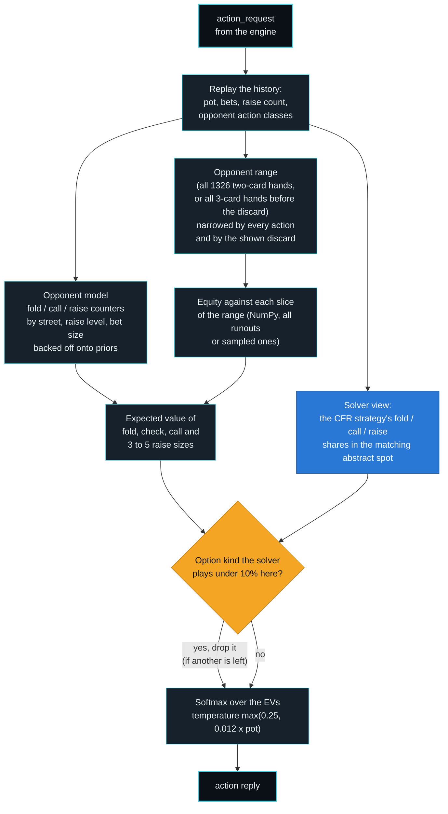

<div align="center">

# Hakari: a Discard Hold'em bot

**Synergy '26 Pokerbots, IIIT Bangalore. Team Hakari.**

[](https://www.python.org/)
[](https://numpy.org/)
[](submission/bot.py)
<br>
[](#results-at-a-glance)
[](#robustness)
[](#robustness)

</div>

This repository is team Hakari's entry for the Pokerbots event of Synergy '26. The game is Discard Hold'em: heads-up no-limit Hold'em with three hole cards, where each player throws one card away face up after the flop betting. The submission is a single file, [`submission/bot.py`](submission/bot.py). It uses only the Python standard library and NumPy.

The bot makes every decision by expected value. It estimates its equity against a range of opponent hands, and it learns from this opponent's actions how often they fold, call and raise. A precomputed game-theory strategy, trained with counterfactual regret minimisation (CFR), follows every hand. When that strategy would almost never make a move in the current spot, the move is dropped. The result plays like an exploitative bot that stays close to sound play.

**Contents:**
[Results at a glance](#results-at-a-glance) ·
[The game](#the-game) ·
[Quick start](#quick-start) ·
[Repository layout](#repository-layout) ·
[Rules compliance](#rules-compliance) ·
[How the bot decides](#how-the-bot-decides) ·
[The solver](#the-solver) ·
[How we tested](#how-we-tested) ·
[What changed and why](#what-changed-and-why) ·
[Robustness](#robustness) ·
[Limitations](#limitations) ·
[Citations](#third-party-code-and-citations) ·
[Team](#team)

## Results at a glance

All numbers come from matches on the organisers' engine, in the official two-leg format, on deals never used to tune the bot. The files in [`results/`](results/) hold the raw summaries. In those files the entry is called `cand36`, its test name. `cand20` and `cand29` are the two versions before it.

**Stage 2 round robin of the 14 strongest test bots**, played by `cand20` (500 duplicate deals per match, 8 deal sets per pair, 728 matches, [`results/round_robin_stage2.txt`](results/round_robin_stage2.txt)):

| Rank | Bot | Match points | Capped chips |
|---:|---|---:|---:|
| 1 | **Hakari (this bot)** | **91.0 of 104** | **+76,217** |
| 2 | f11, rival written from the official documents | 69.0 | +43,930 |
| 3 | cfrS, our CFR solver playing alone | 66.0 | +6,014 |
| 4 | f7, a second, independent CFR solver | 65.0 | +39,468 |
| 5 | rival_a | 64.0 | +7,360 |
| 6 | f10, rival built to exploit common styles | 62.0 | +25,499 |

The bot beat every other bot head to head except f7, where it won 4 of 8. Over all test runs it wins about two thirds of long matches against f7, which is its hardest opponent.

- **Bots built to beat it.** Bots written with the full source code in hand each attack one weakness. Most are copies of the bot with one habit added, so any edge they gain comes from that habit alone.
  - A bot that bets small on every flop lost 28 of 32 long matches to `cand20`. A bot that sets traps, checking strong hands and raising later, came out even with `cand20` ([`results/exploiters_vs_cand20.txt`](results/exploiters_vs_cand20.txt)).
  - A bot that bets all-in minus 2 chips on the turn and river beat `cand20` in 31 of 32 long matches. `cand29` fixed the cause and won 17 of 32 against it, +16 match points (se 3.2) ([`results/near_allin_attacker.txt`](results/near_allin_attacker.txt)).
  - Bots that bet 2x the pot or a random size, only with strong hands, beat `cand29` by about 110 chips per long match. `cand36` fixed the cause: +32 match points over 128 deal sets (se 7.5) against them ([`results/big_bet_attackers.txt`](results/big_bet_attackers.txt)). The same bots bluffing with those sizes gain nothing against it.
- **Rivals it had never met.** Two new bots were written from the organisers' documents only, with no view of this bot or its results. `cand36` won 29 and 28 of 32 long matches against them, and 27 and 18 of 32 short ones ([`results/blind_rivals.txt`](results/blind_rivals.txt)).
- **General field.** Against the 10 strongest test bots, `cand36` scored +11 match points (se 7.0) over `cand29` in 240 long matches and -3 (se 9.1) in 240 short ones ([`results/cand36_vs_cand29_field.txt`](results/cand36_vs_cand29_field.txt)).
- **Robustness.** 0 forfeits and 0 engine notices in every test. On a CPU slowed to one sixth of its speed, it used 26.4 s of the 30 s bank per Stage 1 leg and 65.6 s of 75 s per Stage 2 leg ([`results/slow_core_cand36.txt`](results/slow_core_cand36.txt)).

## The game

| Rule | Value |
|---|---|
| Players | 2, heads-up no-limit |
| Hole cards | 3 each. After the flop betting both players discard 1 card at the same time, and both discards are shown. Turn and river are played with 2 hole cards. |
| Stacks and blinds | 200 chips, reset every hand. Blinds 1 and 2. |
| Raises | At most 4 bets or raises per street. The big blind counts as the first one preflop. |
| Match | Two legs, each with fresh bot processes. Leg 2 replays every deal of leg 1 with cards and seats swapped. Stage 1: 200 deals per leg, 30 s time bank per leg. Stage 2: 500 deals per leg, 75 s per leg. |
| Scoring | The bot with more chips over both legs wins the match: 1 point, 0.5 for a draw. Tie-break: capped chips per hand (each match clipped to plus or minus 400 in Stage 1, 1,000 in Stage 2). |
| Tournament | Stage 1: 6-round Swiss. Stage 2: the top 32 play a full round robin, with scores reset. |

## Quick start

The organisers' starter kit (`engine.py`, `random_bot.py`, the rulebook and the protocol) is not included here. It is their material, and it belongs in `docs/starter_kit/`.

1. Use Python 3.11 with NumPy.

   ```
   pip install numpy
   ```

2. Play a Stage 2 match against the organisers' example bot.

   ```
   python docs/starter_kit/engine.py submission/bot.py docs/starter_kit/example_bots/random_bot.py --stage 2 --seed 1 --python "$(which python3.11)"
   ```

3. Build the upload zip: `bot.py` alone at the top level, with a fixed 1980-01-01 time stamp.

   ```
   python build/mkzip.py submission/bot.py dist/submission.zip
   ```

The bot reads nothing from disk, so the zip holds one file. `submission/bot.py` has md5 `d9294bd16d33bdf325212c3f71910816`.

## Repository layout

| Path | Contents |
|---|---|
| [`submission/bot.py`](submission/bot.py) | The entry. Self-contained: the decision code, the preflop table and the trained solver strategy, embedded as compressed text. |
| [`build/`](build/) | How the entry was assembled: `build_veto.py` merges the solver into the decision code, `cleanup.py` removes the lead-lock code the two-leg rules made useless, then `fix20.py`, `fix29.py`, `fix30.py`, `fix31.py` and `fix32.py` (with `E1=1`) apply the later fixes in that order, and `mkzip.py` makes the upload zip. |
| [`solver/`](solver/) | The CFR trainer (`train.py`), the abstraction it solves (`bot/abstraction.py`), a standalone solver bot, self-checks and [`NOTES.md`](solver/NOTES.md). `bot/strategy.py` here is a small untrained smoke table. The trained table is the one inside `submission/bot.py`. |
| [`lab/`](lab/) | The test harness: match runners, paired comparisons, the round robin, the divergence analysis, test-opponent generators and the release checks. See [How we tested](#how-we-tested). |
| [`lab/candidates/`](lab/candidates/) | Patches for changes that were tested and either rejected or are still being tested. |
| [`results/`](results/) | Result summaries cited in this README. |
| [`decisions.tsv`](decisions.tsv) | One row per decision: what, why, the evidence, and what happened. |
| [`pokerbots/`](pokerbots/), [`scripts/`](scripts/), [`tests/`](tests/) | The first framework: our own engine, hand evaluator, equity code and early bots, with unit tests. The final bot no longer imports it, but it holds the evaluator tests and the early experiments. |
| [`docs/RELEASE_DAY.md`](docs/RELEASE_DAY.md) | The checklist for an upload. |

## Rules compliance

| Rule | What this entry does |
|---|---|
| Python 3.11, standard library, NumPy and SciPy only | Standard library and NumPy. Tested under NumPy 2.4.6, 1.26 and 1.23 on Python 3.11 ([`results/numpy_versions_cand36.txt`](results/numpy_versions_cand36.txt)). |
| One `bot.py`, or a zip with `bot.py` at the top, at most 5 MB | One `bot.py` of 1.4 MB. The zip is 1.0 MB. |
| No writing files, no network, no subprocesses | None of these are used. All tables are embedded in the file and decoded in memory at start-up. |
| 1 vCPU, 1 GB RAM | Runs on one core. Peak memory 75 MB. |
| Time bank, crash means forfeit | The bot paces itself against the bank and gets simpler when time runs short (see [Robustness](#robustness)). Any exception inside a decision falls back to a legal check, fold or discard, so a bad message cannot crash it. |
| Own work, no copied bot code | All code was written by the team. The algorithms are published ones: CFR and its discounted variant, pseudo-harmonic action mapping, Bayesian range updates. See [Citations](#third-party-code-and-citations). |
| No state between legs | Each leg starts from the same priors. Nothing is written or read between legs. |

## How the bot decides



1. **State.** Every request replays the history the engine sends. The bot tracks the pot, both bets, the raise count and the class of each opponent action: fold, check or call, or raise (small, medium, big, all-in). A test harness confirmed the tracked state matches the engine's on every request over 300 hands against 6 styles of opponent.
2. **Hand tables.** On each street, NumPy scores all 1,326 two-card hands on the current board. The turn and river are enumerated exactly. The flop samples 240 runouts, fewer if time runs short. Preflop and flop decisions use 3-card hands and a model of which two cards each player will keep.
3. **Opponent range.** A weight for every possible opponent hand. Each opponent action is read as a slice of the strength order. For example, a raise that this opponent makes 20% of the time keeps the strongest 20% of the remaining range, softened by a learnt rate of off-pattern plays such as bluffs and slow-plays. The shown discard removes hands the opponent would not have thrown that card from. The model of how this opponent discards (best keep, lowest card, or random) is learnt from showdowns.
4. **Opponent model.** Counters of the opponent's fold, call and raise choices, kept at three levels of detail (all streets, per street, per bet size). They start from priors and move towards this opponent's actual habits.
5. **Expected value.** Fold is 0. A call wins its equity share of the pot, adjusted for the streets still to come. A raise adds the chance the opponent folds now, and values their call and their re-raise separately. Raise sizes come from the pot (a third, two thirds, one pot, one and a half pots, all-in) and from the bet faced.
6. **Solver check.** The CFR strategy follows the same hand. If it plays an option kind (fold, check or call, raise) under 10% of the time in the matching spot, that kind is removed, as long as another option remains. Exploiting an opponent can then never take the bot far from sound play. Two cases switch the check off: a bet the solver's tree has no size for, and a spot that has left the tree.
7. **Choice.** A softmax over the remaining EVs. Options more than three temperatures below the best are never picked. The randomness stops an observant opponent from reading exact thresholds.

## The solver

The trainer and the abstraction are in [`solver/`](solver/), and [`solver/NOTES.md`](solver/NOTES.md) gives the details.

| Part | Choice |
|---|---|
| Cards, preflop | Exact suit-isomorphic class of the 3 hole cards: 1,755 buckets |
| Cards, flop | Mean and spread of the best two-card keep's percentile over 48 fixed runouts: 512 buckets |
| Cards, turn and river | Strength against the opponent's plausible kept hands: 192 buckets each |
| Bets | Preflop open 1 or 2 pots, first re-raise 0.75 pot. Postflop first bet 0.33, 0.66 or 1 pot, first raise 0.75 pot. Later raises are all-in only. All-in is always offered. |
| Tree | 6,476 public states, 3,392 decision nodes, 758,044 information sets |
| Training | Chance-sampled discounted CFR (alpha 1.5, beta 0, gamma 2) on 19.2 M pre-dealt deals, NumPy passes over the whole tree, 14 worker processes |
| Real bets onto the tree | Randomised pseudo-harmonic mapping between the two nearest abstract sizes, fixed for the rest of the hand |

Playing alone, the solver came third in the round robin above. It is hard to beat, and it never adapts to a weak opponent. Inside Hakari it serves as the safety check described above.

## How we tested

**Match format.** Every test match uses the organisers' engine and the official two-leg format. Each deal is played twice with cards and seats swapped, so card luck largely cancels out.

**Paired comparisons.** A change is tested by running the old and the new version on the same deal sets against the same opponents. Each result below gives the difference with its standard error (se), the size of the swing that luck alone can cause. A difference under 2 se is treated as no difference. Seeds are never reused once a decision has been made on them.

**Test field** (33 opponents):

| Group | Bots |
|---|---|
| CFR solvers | cfrS (ours, alone), cfr2 (a smaller solver), f7 and f9 (independent solvers) |
| Rivals written only from the organisers' documents | f1 to f11, each written separately with no view of our code. f10 targets common styles. f11 is the strongest of them. |
| Earlier rival bots | rival_a, rival_b, rival_c and two variants, plus locker, which folds out a leg once its lead covers the remaining blinds |
| Fixed styles | 14 simple bots: always call, always shove, maniac, nit, min-raiser, pot-odds caller, loose, tight and others |

**Test opponents for single weaknesses.** Wrappers rewrite one habit of a strong bot and leave the rest unchanged. The generators are in `lab/`:
- `minrr_gen.py` makes re-raises minimum-sized.
- `disc_gen.py` discards the lowest card, as the starter kit does.
- `minbet_gen.py` bets the minimum.
- `iso_gen.py` raises every limp.
- `njv_gen.sh` and `fz_gen.py` add near-all-in bets, pot-multiple bets or random-sized bets to a copy of the bot.
- `sw_gen.py` switches style halfway through each leg.

A fix has to win its targeted test and must not lose to the general field.

**Code reviews, bots built to beat it, and blind rivals.** Eight independent reviews each checked one part of the code by running it:
- state tracking against the engine, over 11,457 replayed decisions;
- the opponent model's counters;
- EV formulas;
- equity numbers against a brute-force count;
- the preflop path;
- every assumption the solver makes, and how its strategy is looked up during play.

Bots were also written with full access to the code to beat this one. Each finding became a candidate change and went through the paired tests. Two more rivals were written from the official documents alone, as a check against opponents nothing was tuned on. `lab/audit.py` scans match logs for moves that are wrong whatever the opponent holds: none were found in over 32,000 river decisions.

**Main tools in `lab/`:**

| Tool | Job |
|---|---|
| `legrun.py`, `rrun.py` | Run many two-leg matches in parallel on the organisers' engine (one bot against many, or all pairs) |
| `legsum.py`, `mrsum.py`, `pairavg.py`, `rrsum.py` | Paired comparison with standard errors (`pairavg.py` averages repeated runs of a deal set first), per-opponent tables, round-robin standings |
| `ob_audit.py` | For every answer to a bet of 1.2x the pot or more: chips gained compared with folding, by street, answer and bet size |
| `audit.py` | Moves that lose whatever the opponent holds: river folds of the best possible hand, river calls with a hand that beats nothing, turn folds of a hand that cannot lose |
| `dup.py` | Duplicate-deal divergence: finds the first decision where we and the opponent chose differently with the same cards, and totals the chips that followed |
| `rr.py` | How deep re-raises are sized and answered |
| `gen_pre2.py` | Rebuilds the preflop table with exact card removal, with a brute-force self-test |
| `newcheck.sh`, `slow6.sh`, `npcheck.sh` | Release checks: organiser engine, unknown messages, start-up time, memory, slowed CPU, older NumPy |

## What changed and why

[`decisions.tsv`](decisions.tsv) holds the full log. The main steps:

| Change | Evidence | Result |
|---|---|---|
| Expected-value bot with an opponent model | Beats every rule-based style, but lost about 1.2 chips per hand to our CFR solver | Base of the entry |
| Hybrid: solver plays the first part of each match, the EV bot the rest | No gain over 1,000 hands against the solver | Rejected |
| Solver check on option kinds from the flop on, threshold 10% (2%, 5% and 10% tried) | 345 of 380 test matches won, against 326 for the EV bot alone | Kept |
| Solver check from preflop | +20 points (se 7.7) over 308 Stage 2 matches | Kept |
| Lead lock (fold out once the lead covers the blinds left) | Under the two-leg rules a leg cannot see the other leg's chips, so a lead is never safe | Removed; same moves proven on fixed seeds |
| Softmax temperature halved or doubled | Both directions came out "better" (+5, se 5.6 and +6, se 4.9), a sign of luck on shared deals | Rejected |
| A small re-raise late in a betting round was read as an all-in by the solver's tree, forcing folds | Against bots that re-raise small: +172 capped chips per match (se 86) and +3 points (se 2.6); no change against the general field (-4 points, se 9.4, over 488 matches) | Kept in the entry |
| Discard named by the card itself, not its position in the message | No effect with the current engine; protects against a reordered message | Kept |
| Solver check off after the flop against bots that discard by a fixed rule | Against such bots: -12 points (se 3.3) over 96 Stage 2 matches ([`results/cand21_rejected.txt`](results/cand21_rejected.txt)) | Rejected |
| Bets just below all-in were read as cheap, and the solver check was off for them | A copy of the bot that bets all-in minus 2 chips beat `cand20` in 31 of 32 long matches; after the fix, +16 points (se 3.2) against it and +5 (se 7.3) against the general field | Kept (`cand29`) |
| The share of weak hands seen behind big bets was applied as a per-hand weight, so a bet made 10% of the time was read as 57% weak when 15% were | Re-raises over turn bets of 1.2x the pot or more lost 48 chips each (se 13); after the fix, +32 points over 128 deal sets (se 7.5) against value big-bet bots, no loss against big-bet bluffers, +11 (se 7.0) against the general field | Kept (`cand36`) |
| A call at the raise cap or with us all-in read as "chose not to raise"; the call EV took the call off the stack twice | Bugs shown by replaying logged decisions | Kept (`cand36`) |
| Exact card removal in the preflop table | +256 chips per long match against f7 (se 123), but no gain on the general field, and -6 points (se 6.9) on top of `cand36` | Rejected |
| Slow-play rate learnt as P(passive given strong) | -4 points (se 4.2) against the trap bot it was meant for | Rejected |
| Corrections where real bets meet the solver's tree; no solver check for bets far cheaper than the tree size | -3 points (se 3.3) against min-bet bots; -88 chips per match (se 65) against min-raise bots | Rejected |
| Separate counters for acting first and acting after our check or limp | -2.5 points (se 4.6) against bots that raise every limp | Rejected |
| Range slices read inside equity buckets; solver features rounded as in training | Correct by a brute-force check, but no measurable change: -4 points (se 6.9) long, +8 (se 5.1) short | Not shipped; more deals to come |

## Robustness

From [`results/engine_checks_cand36.txt`](results/engine_checks_cand36.txt), [`results/slow_core_cand36.txt`](results/slow_core_cand36.txt) and [`results/numpy_versions_cand36.txt`](results/numpy_versions_cand36.txt):

| Check | Result |
|---|---|
| Organiser engine, Stage 1 and Stage 2, against the starter and random bots | 0 notices, 0 lines on stderr |
| Time used, Stage 2 against the starter bot | About 35 s of the 75 s bank per leg |
| CPU slowed to one sixth (5 busy processes on the same core) | Stage 1: 26.4 s of 30 s per leg. Stage 2: 65.6 s of 75 s per leg. 0 notices. |
| Start-up to exit | 0.90 to 0.93 s (limit 5 s) |
| Peak memory | 75 MB (limit 1 GB) |
| Unknown message types and fields | Ignored, 0 notices |
| A 998-hand match | Clean |
| NumPy 1.26 and 1.23 | Clean |

How the bot handles time: the solver view runs only while the match is ahead of a schedule that spreads 80% of the bank evenly over the hands. Flop runouts shrink from 240 to 60 when the bank runs low. Below 1 s of bank it checks or folds. Replies take well under the 5 s per-reply limit.

## Limitations

- Every opponent we tested against was built by us or written for this test. None is a real entrant, so the strength of the real field is unknown.
- f7, an independent CFR solver, is the closest matchup: about two wins in three over long matches. A stronger solver than any we built could beat this bot.
- The bot that sets traps came out even with `cand20`. It may hold a small real edge (about 0.2 chips per hand), within luck so far. The fix aimed at it did worse and was rejected.
- f17, a rival built around fast opponent modelling, won 14 of 32 short Stage 1 matches against this bot, though only 4 of 32 long ones ([`results/blind_rivals.txt`](results/blind_rivals.txt)). Short matches give our opponent model less time to learn.
- The opponent model starts from the same priors in both legs. Learning restarts with each fresh process, as the rules require.
- On a machine much slower than one sixth of our test server, the flop runouts and the solver view are cut back, and play gets simpler.

## Third-party code and citations

- NumPy, for all array work. No other library.
- Counterfactual regret minimisation: M. Zinkevich, M. Johanson, M. Bowling, C. Piccione, "Regret Minimization in Games with Incomplete Information", NeurIPS 2007.
- Discounted CFR: N. Brown, T. Sandholm, "Solving Imperfect-Information Games via Discounted Regret Minimization", AAAI 2019.
- Monte Carlo sampling for CFR: M. Lanctot, K. Waugh, M. Zinkevich, M. Bowling, "Monte Carlo Sampling for Regret Minimization in Extensive Games", NeurIPS 2009.
- Pseudo-harmonic action mapping: S. Ganzfried, T. Sandholm, "Action Translation in Extensive-Form Games with Large Action Spaces", IJCAI 2013.
- The organisers' starter kit and engine were used for testing. They are not redistributed here.

## Team

Team Hakari, Synergy '26 Pokerbots, IIIT Bangalore:

- Bhavya Jain
- Kanav Bhardwaj
